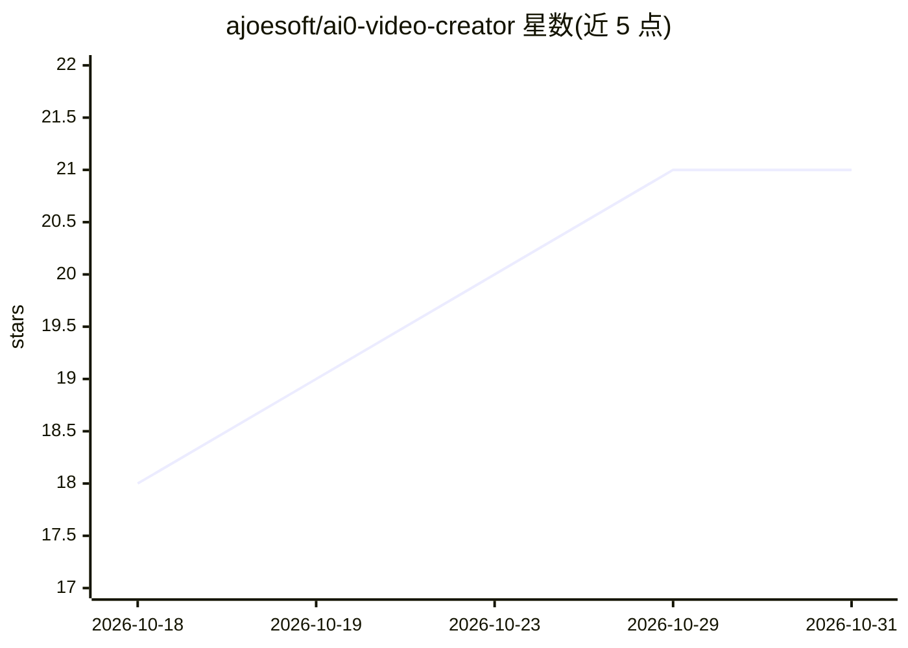

# ajoesoft/ai0-video-creator

⭐ 21 · TypeScript · 推送 2026-09-15 · [GitHub](https://github.com/ajoesoft/ai0-video-creator) · [官网](https://ajoesoft.github.io/) · 个人维护 · 中文 README

**桌面 AI 视频创作工作台：从脚本到成片的全链路工具**

基于 Tauri v2 + Rust + React 19 + SQLite 的桌面影音创作应用，面向 AI 内容创作者与开发者，覆盖五种创作模式：竖屏短视频、横版故事、多角色对话、双语词卡、视频翻译与唇形同步（LTX2.3/Wav2Lip）。AI 编排上通过 Ollama 本地 LLM 写脚本、ComfyUI 工作流桥接生图生视频、Gemini SDK 翻译、火山引擎语音克隆与 Qwen3-TTS 配音。提供通用 ComfyUI 工作流适配器按节点标题注入字段。源码构建需 Node.js 18+ 与 Rust/Cargo；许可为 BSL 1.1，商用需另行授权。

## 筛选速览

| 维度 | 判定 | 备注 |
|---|---|---|
| AI 角色 | `ai-native` | 本体是模型或模型工具 |
| 许可风险 | `none` | — |
| 部署形态 | `library` | 以包/库形式分发 |
| 模型依赖 | local-ok | 支持本地模型 |
| 硬件要求 | — | 无带数字的原话,不猜 |
| 安装摩擦 | `medium` | 含编译或系统依赖之一 |
| 成熟度 | — | 结构信号不足 |

## 能力要点

- 五种创作模式：短视频/故事/多角色对话/双语词卡/视频翻译唇形同步
- 通用 ComfyUI 工作流适配器，按节点标题注入文案/图片/音频
- Ollama 本地 LLM 编写脚本，ComfyUI WS/API 桥接生图生视频
- 视频翻译链路：字幕提取 + Gemini 翻译 + 语音克隆 + LTX2.3/Wav2Lip 对口型

## 适用场景

- 一站式制作竖屏短视频与横版剧情视频
- 给外语视频做翻译、克隆配音和唇形同步
- 制作多角色对话视频和双语词汇学习卡片
- 接入自己的 ComfyUI 工作流批量生成视频素材

## 场景标签

`视频生成` `AI 写作` `语音合成` `图像生成` · 领域:内容生成

## 证据(README 行号)

> L22: Whether you are crafting short vertical reels, horizontal narrative stories, multi-actor conversations, vocabulary 
> L56: * Automated text translation powered by the unified `@google/genai` (Gemini-1.5/2.0/3.5) SDK.
> L57: * Multi-actor voice cloning utilizing **Volcengine Voice Clone App** and **Qwen3-TTS**.

## 星数曲线

2026-10-18 18 → 2026-10-31 21（+3）

---
*卡片 v1 · prompt 1.4 · 生成 2026-10-28 · 置信度 high · 依据 README sha `70cabbf10af9` · [字段定义](../../DATASET.md)*
