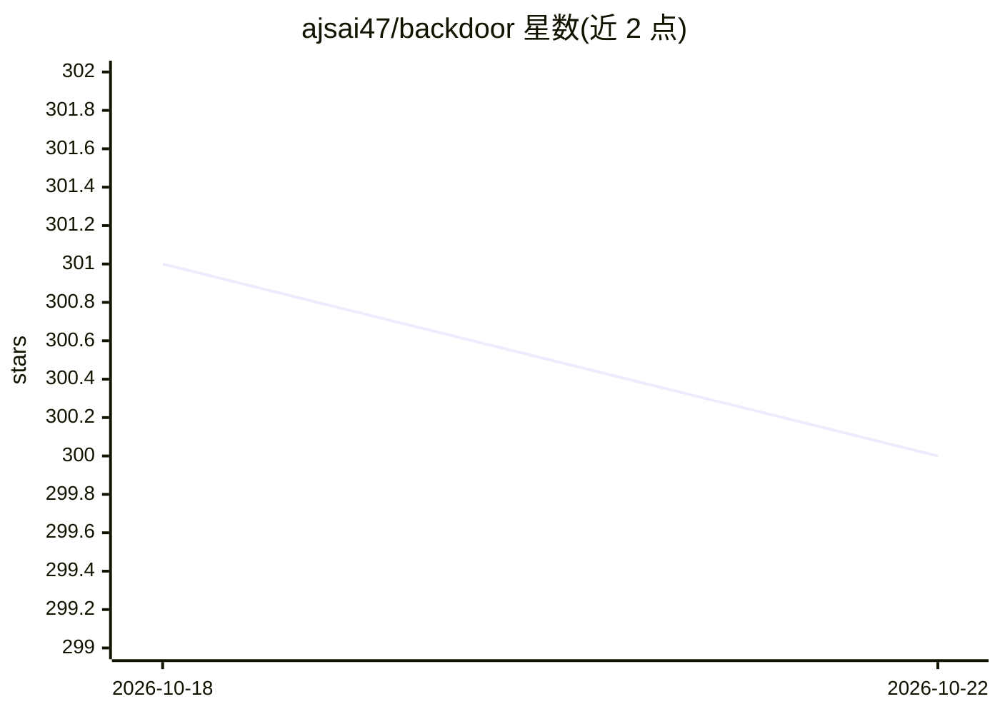

# ajsai47/backdoor

⭐ 300 · Python · MIT · 推送 2026-05-22 · [GitHub](https://github.com/ajsai47/backdoor) · 个人维护

**让 Claude Code 接入任意 OpenAI 兼容模型提供方的代理**

一个轻量本地代理（不足 600 行代码，MIT 许可）：拦截 Claude Code 发往 Anthropic API 的请求，转换为 OpenAI chat completions 格式并转发到 DeepSeek、Groq、NVIDIA NIM、OpenRouter、Ollama、LM Studio 等任意 OpenAI 兼容提供方，再把响应实时转回 Anthropic SSE 格式，透明处理工具调用、流式增量与 token 计数；Claude Code 内部配额探测等请求在本地短路。面向希望摆脱单一 API 锁定、降低成本或本地私有运行的 Claude Code 用户。安装方式为 git clone 后运行 ./backdoor 向导，或手动配置 .env 后运行 ./run.sh。附赠通过 Telegram 触发会话的功能。

## 筛选速览

| 维度 | 判定 | 备注 |
|---|---|---|
| AI 角色 | `ai-ecosystem` | LLM/agent 周边工具 |
| 许可风险 | `permissive` | MIT |
| 部署形态 | `None` |  |
| 模型依赖 | local-ok | 支持本地模型 |
| 硬件要求 | — | 无带数字的原话,不猜 |
| 安装摩擦 | `low` | 无编译、无系统依赖或容器化 |
| 成熟度 | — | 结构信号不足 |

## 能力要点

- Anthropic Messages API 与 OpenAI 格式双向转换，透明处理工具调用与流式响应
- 支持 DeepSeek/Groq/NVIDIA NIM/OpenRouter/Ollama/LM Studio 等提供方，改三行 .env 即可切换
- 本地短路 Claude Code 内部配额探测等请求，避免消耗提供方配额
- 通过 Telegram Bot 可从手机触发 Claude Code 会话

## 适用场景

- 把 Claude Code 切到 DeepSeek 等低成本 API 上继续使用原界面与工具
- 指向本地 Ollama 实现完全私有的编码助手
- 在 Llama/Mistral/DeepSeek 等模型间做实际工作负载对比
- 在手机上通过 Telegram 远程触发 Claude Code 任务

## 场景标签

`模型网关` · 领域:Agent 开发

## 证据(README 行号)

> L28: Backdoor is a lightweight proxy that intercepts Claude Code's API calls and reroutes them to any OpenAI-compatible 
> L138: Claude Code talks to `localhost:8082` thinking it's Anthropic. Backdoor receives the request, translates it from A

## 星数曲线

2026-10-18 301 → 2026-10-22 300（-1）

---
*卡片 v1 · prompt 1.4 · 生成 2026-10-21 · 置信度 high · 依据 README sha `8e209156c337` · [字段定义](../../DATASET.md)*
