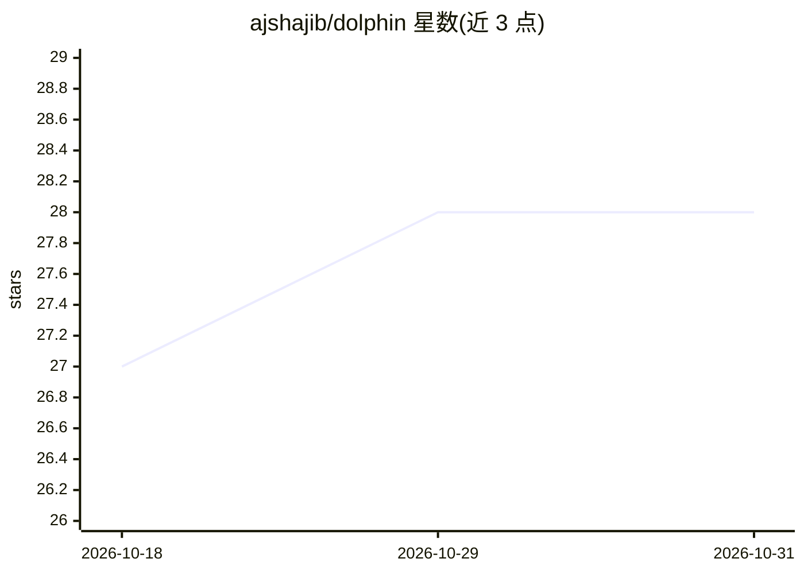

# ajshajib/dolphin

⭐ 28 · Jupyter Notebook · BSD-3-Clause · 推送 2026-10-28 · [GitHub](https://github.com/ajshajib/dolphin) · [官网](https://dolphin-docs.readthedocs.io) · 个人维护

**给科研用户的强引力透镜自动建模流水线**

基于 lenstronomy 建模引擎的强引力透镜自动化建模流水线，面向研究星系尺度透镜的天文研究人员。提供 AI 驱动的前向建模方式，支持全自动化运行与半自动（可人工调整 AI 生成配置）两种工作流，支持多波段同时建模，内置 galaxy–galaxy 与 galaxy–quasar 两类透镜系统，并支持本地机与高性能计算集群（HPCC）间的同步。通过 pip 安装（包名 space-dolphin），配套论文发表于 ApJ 2025。

## 筛选速览

| 维度 | 判定 | 备注 |
|---|---|---|
| AI 角色 | `ai-native` | 本体是模型或模型工具 |
| 许可风险 | `permissive` | BSD-3-Clause |
| 部署形态 | `library` | 以包/库形式分发 |
| 模型依赖 | — | README 未给出锁定关系 |
| 硬件要求 | — | 无带数字的原话,不猜 |
| 安装摩擦 | `low` | 无编译、无系统依赖或容器化 |
| 成熟度 | — | 结构信号不足 |

## 能力要点

- 基于 lenstronomy 引擎的自动化前向建模流水线
- 全自动与半自动（人工覆写）两种工作流
- 多波段同时配置与建模
- galaxy–galaxy 与 galaxy–quasar 透镜系统内置支持
- 本地与高性能计算集群（HPCC）间同步设置

## 适用场景

- 我需要批量处理大样本强引力透镜的建模
- 我想在 HPC 集群上运行透镜建模流水线
- 我想在自动建模基础上人工微调配置

## 场景标签

`科研工具` · 领域:学习与行业

## 证据(README 行号)

> L33: Welcome to **dolphin**, an AI-powered automated pipeline for strong gravitational lens modeling!
> L35: ``dolphin`` leverages `lenstronomy <https://github.com/lenstronomy/lenstronomy>`_ as its core modeling engine, prov
> L39: Strong gravitational lens modeling traditionally requires significant manual effort. ``dolphin`` changes this by pr

## 星数曲线

2026-10-18 27 → 2026-10-31 28（+1）

---
*卡片 v1 · prompt 1.4 · 生成 2026-10-26 · 置信度 high · 依据 README sha `07a1d10c5427` · [字段定义](../../DATASET.md)*
