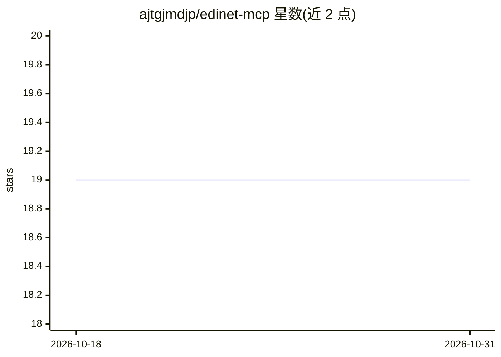

# ajtgjmdjp/edinet-mcp

⭐ 19 · Python · Apache-2.0 · 推送 2026-10-26 · [GitHub](https://github.com/ajtgjmdjp/edinet-mcp) · [官网](https://pypi.org/project/edinet-mcp/) · 个人维护 · 中文 README

**日本 EDINET 财务披露的 XBRL 解析库与 MCP 服务器**

面向需要获取日本上市公司财务数据的开发者：解析 EDINET 披露的 XBRL 文件，跨 J-GAAP/IFRS/US-GAAP 会计准则将科目归一化为日/英双语标准标签，输出 BS/PL/CF 财务报表、ROE/ROA 等指标、叙事章节（风险/MD&A）与跨期比较。以 Python 库 + CLI + 11 工具 MCP 服务器形式提供，供 Claude Desktop/Cursor 等 AI 工具调用；XBRL 解析本地运行，仅需免费 EDINET API key。Apache-2.0 许可。

## 筛选速览

| 维度 | 判定 | 备注 |
|---|---|---|
| AI 角色 | `ai-ecosystem` | LLM/agent 周边工具 |
| 许可风险 | `permissive` | Apache-2.0 |
| 部署形态 | `self-host` | docker 或自建部署 |
| 模型依赖 | — | README 未给出锁定关系 |
| 硬件要求 | — | 无带数字的原话,不猜 |
| 安装摩擦 | `low` | 无编译、无系统依赖或容器化 |
| 成熟度 | — | 结构信号不足 |

## 能力要点

- 跨 J-GAAP/IFRS/US-GAAP 的科目自动归一化（taxonomy.yaml 161 项映射）
- MCP 服务器提供 11 个工具，供 Claude Desktop/Cursor 等 AI 工具调用
- 支持最多 20 家公司财务指标一括比较与跨期增减分析
- 可选 evidence receipts：基于 xbrl-facts Rust 引擎的可验证数据溯源记录

## 适用场景

- 让 AI 助手直接查询日本上市公司的财报数据与风险章节
- 批量解析 EDINET 披露文件并归一化为 DataFrame 做分析
- 多公司财务指标筛选与跨期对比

## 场景标签

`文档解析` `金融量化` · 领域:知识与检索

## 证据(README 行号)

> L37: **edinet-mcp** provides programmatic access to Japan's EDINET financial disclosure system. It normalizes XBRL filin
> L49: - MCP server with 11 tools for Claude Desktop and other AI tools

## 星数曲线

2026-10-18 19 → 2026-10-31 19（+0）

---
*卡片 v1 · prompt 1.4 · 生成 2026-10-28 · 置信度 high · 依据 README sha `46680eb8c96a` · [字段定义](../../DATASET.md)*
