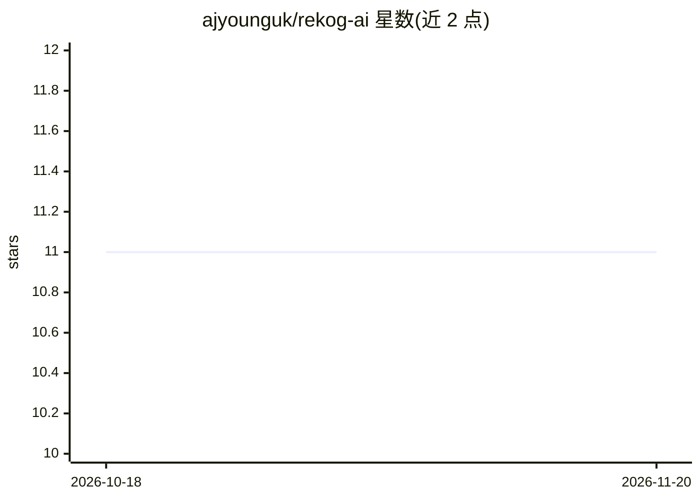

# ajyounguk/rekog-ai

⭐ 11 · JavaScript · 推送 2026-11-16 · [GitHub](https://github.com/ajyounguk/rekog-ai) · 个人维护

**本地 Web 应用：上传图片查看 AWS Rekognition 识别结果**

基于 Node.js/Express/EJS 与 AWS SDK v3 的本地 Web 应用，调用 Amazon Rekognition 的三个 Detect API（DetectLabels、DetectText、DetectFaces）并汇总展示标签、文本行、人脸属性及原始 API 响应。支持样本图与上传图（PNG/JPEG，≤5MB），凭据走 AWS SDK 默认凭据链（SSO、profile、环境变量、实例角色），可用 LocalStack 或自定义端点做本地/替换调用。无认证，默认绑定 127.0.0.1；每次分析产生 3 次计费 API 调用。

## 筛选速览

| 维度 | 判定 | 备注 |
|---|---|---|
| AI 角色 | `ai-native` | 本体是模型或模型工具 |
| 许可风险 | `none` | — |
| 部署形态 | `library` | 以包/库形式分发 |
| 模型依赖 | — | README 未给出锁定关系 |
| 硬件要求 | — | 无带数字的原话,不猜 |
| 安装摩擦 | `low` | 无编译、无系统依赖或容器化 |
| 成熟度 | — | 结构信号不足 |

## 能力要点

- 并行调用 DetectLabels/DetectText/DetectFaces 并汇总结果
- AWS SDK 默认凭据链，支持 IAM Identity Center 短期凭据
- 支持 LocalStack/自定义端点覆盖，侧栏徽标指示调用目标
- 内置 node:test 测试套件，无需 AWS 访问即可运行

## 适用场景

- 本地试用 Amazon Rekognition 的标签/文本/人脸检测能力
- 查看 Rekognition API 原始响应与请求 ID 以便调试
- 配合 LocalStack 在无 AWS 计费的环境下测试集成

## 场景标签

`人脸识别` `目标检测` · 领域:感知与多模态

## 证据(README 行号)

> L3: A small local web app for trying out Amazon Rekognition. Pick a sample image or
> L6: - **Labels** - objects, scenes and concepts, with confidence and parent labels
> L11: Written in Node.js with Express, EJS and the AWS SDK for JavaScript v3.

## 星数曲线

2026-10-18 11 → 2026-11-20 11（+0）

---
*卡片 v1 · prompt 1.4 · 生成 2026-11-18 · 置信度 high · 依据 README sha `a9dcd7e8d238` · [字段定义](../../DATASET.md)*
