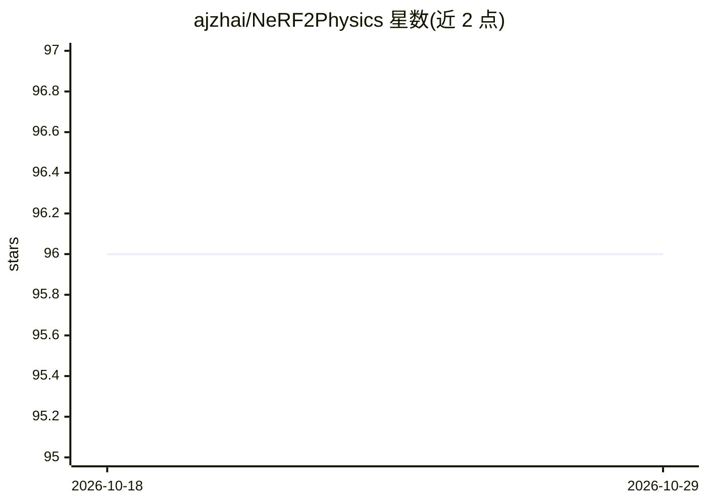

# ajzhai/NeRF2Physics

⭐ 96 · Python · MIT · 推送 2025-11-16 · [GitHub](https://github.com/ajzhai/NeRF2Physics) · [官网](https://ajzhai.github.io/NeRF2Physics/) · 组织维护

**从语言嵌入特征场推断 3D 物体物理属性的 CVPR 2024 研究代码**

UIUC 团队 CVPR 2024 论文官方实现：对多视角图像先做 NeRF 重建（经 Nerfstudio）提取深度图与点云，融合 CLIP 特征并用 BLIP-2 生成描述与选择视角，再调用 GPT 提出候选材料，最终以 CLIP 核回归在 3D 空间中稠密预测物理属性（密度/摩擦/邵氏硬度）。提供 ABO-500 数据集（含中间输出）与摩擦/硬度数据集，可从流水线任意步骤切入运行。仅支持三种属性，GPT 步骤需 OpenAI API key。

## 筛选速览

| 维度 | 判定 | 备注 |
|---|---|---|
| AI 角色 | `ai-native` | 本体是模型或模型工具 |
| 许可风险 | `permissive` | MIT |
| 部署形态 | `library` | 以包/库形式分发 |
| 模型依赖 | — | README 未给出锁定关系 |
| 硬件要求 | — | 无带数字的原话,不猜 |
| 安装摩擦 | `low` | 无编译、无系统依赖或容器化 |
| 成熟度 | — | 结构信号不足 |

## 能力要点

- NeRF 重建 + CLIP 特征融合 + BLIP-2 描述 + GPT 材料提议的流水线
- 以 CLIP 核回归稠密预测 3D 物理属性（体积积分或网格模式）
- 提供 AO-500 数据集及摩擦/硬度 13 场景数据集
- 各组件独立脚本，可从任意中间步骤开始运行

## 适用场景

- 我在做多视角图像的物体质量/密度估计研究
- 我想在自定义数据上复现或扩展物理属性预测方法
- 我需要带真值重量与摩擦/硬度测量的多视角数据集

## 场景标签

 · 领域:3D 计算机视觉/场景理解

## 证据(README 行号)

> L10: **Infer physical properties densely in 3D for any object!**
> L69: Material proposal is done in `material_proposal.py`. You can specify the physical property of interest using the `-
> L76: Physical properties are predicted using CLIP-based kernel regression in `predict_property.py`. Example (only proces

## 星数曲线

2026-10-18 96 → 2026-10-29 96（+0）

---
*卡片 v1 · prompt 1.4 · 生成 2026-10-23 · 置信度 mid · 依据 README sha `37df42487274` · [字段定义](../../DATASET.md)*
