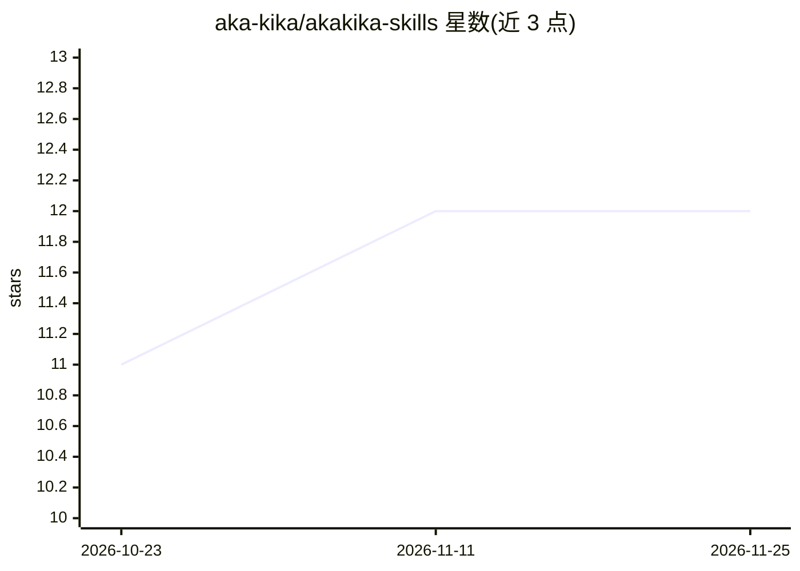

# aka-kika/akakika-skills

⭐ 12 · TypeScript · MIT · 推送 2026-10-30 · [GitHub](https://github.com/aka-kika/akakika-skills) · [官网](https://akakika-skills.vercel.app) · 个人维护

**面向 AI 编码 agent 用户的 40 个 SKILL.md 技能合集**

收录 40 个 SKILL.md 格式的 agent 技能，按项目生命周期组织为 9 类：项目决策、设计系统、Apple HIG、Swift/macOS 实现、AI agent 工作流、会话仪式、维护、发布评审、内容发布。提供一键安装脚本，将全部技能以符号链接装入 Claude Code、Grok、Goose、Cursor、Codex 等技能目录；也可手动复制单个技能文件夹。技能为纯 Markdown 加少量 YAML frontmatter，无构建步骤与依赖。MIT 许可，附可搜索的浏览站点。

## 筛选速览

| 维度 | 判定 | 备注 |
|---|---|---|
| AI 角色 | `ai-knowledge` | 知识聚合/清单类 |
| 许可风险 | `permissive` | MIT |
| 部署形态 | `None` |  |
| 模型依赖 | local-ok | 支持本地模型 |
| 硬件要求 | — | 无带数字的原话,不猜 |
| 安装摩擦 | `low` | 无编译、无系统依赖或容器化 |
| 成熟度 | — | 结构信号不足 |

## 能力要点

- 40 个 SKILL.md 技能按项目生命周期分 9 类组织
- 一键 install.sh 将技能 symlink 到 5 个 agent 的技能目录（含 --dry-run/--copy/--targets 选项）
- 覆盖 Apple HIG、SwiftUI、macOS 权限/通知/公证等原生开发主题
- 技能兼容任何读取 SKILL.md 格式的 agent，纯 Markdown 无依赖

## 适用场景

- 为 Claude Code/Codex/Cursor 等编码 agent 补充 macOS 原生设计技能
- 搭建 agent 可驱动的项目（AGENTS.md 与引导脚本）
- 在编码 agent 会话之间做审计与收尾管理
- 查找 App Store 外分发（Developer ID/公证/DMG）的操作指引

## 场景标签

`提示工程` · 领域:Agent 开发

## 证据(README 行号)

> L14: These are agent skills — plain `SKILL.md` files that teach an AI coding agent how to do one thing *well*. They work
> L18: The collection follows the life of a project — decide, design, build, run, maintain, launch, tell people, close the
> L177: Each skill is a folder with a `SKILL.md`: a little YAML frontmatter (a `name` and a `description` that starts with

## 星数曲线

2026-10-23 11 → 2026-11-25 12（+1）

---
*卡片 v1 · prompt 1.4 · 生成 2026-11-18 · 置信度 high · 依据 README sha `b27925114c4c` · [字段定义](../../DATASET.md)*
