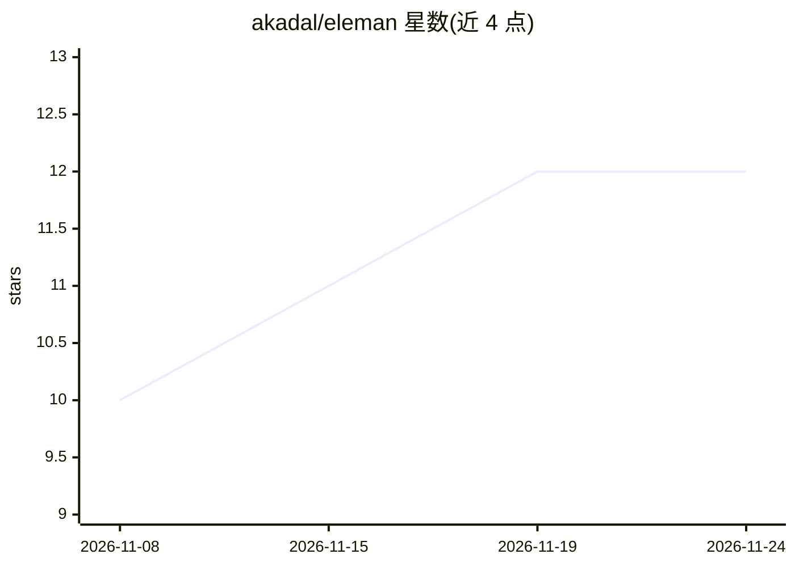

# akadal/eleman

⭐ 12 · Python · MIT · 推送 2026-11-19 · [GitHub](https://github.com/akadal/eleman) · [官网](https://eleman.akadal.tr) · 个人维护

**为 AI 助手提供个人长期记忆的 markdown+git 仓库模板**

eleman 是一个供 AI 助手读写个人长期记忆的仓库模板，而非可运行的服务：对话内容先进入不可变的 inbox 日志，由整理（consolidation）流程蒸馏为带预算的主题文件，事实唯一存放并以时间语法区分事件、持续状态与作废记录；通过根表→领域索引的路由减少读取轮次，并带 lint 与 golden-set 评估脚本。仅依赖 Python 标准库，无守护进程、数据库或 API key；安装方式为以模板创建私有仓库并克隆，由 agent 自行执行首次设置访谈。隐私设计要求仓库私有、secret/ 目录结构性排除、默认拒绝数据外发。

## 筛选速览

| 维度 | 判定 | 备注 |
|---|---|---|
| AI 角色 | `ai-ecosystem` | LLM/agent 周边工具 |
| 许可风险 | `permissive` | MIT |
| 部署形态 | `None` |  |
| 模型依赖 | — | README 未给出锁定关系 |
| 硬件要求 | — | 无带数字的原话,不猜 |
| 安装摩擦 | `low` | 无编译、无系统依赖或容器化 |
| 成熟度 | — | 结构信号不足 |

## 能力要点

- 两层结构：append-only 原始日志 + 可重建的蒸馏主题文件
- 唯一写入门与事实唯一归属，消除同一事实多副本导致的上下文串扰
- 时间语法区分发生/仍然为真/曾为真/从未为真，lint 作为提交唯一门禁
- 纯标准库 Python，无守护进程、数据库与 API key

## 适用场景

- 让 Claude Code/Codex/Cursor 等助手跨会话记住个人信息与工作事项
- 用 git 作为审计轨迹，随时查看并编辑助手掌握的记忆
- 个人知识管理：家庭、健康、工作等领域文件分区维护

## 场景标签

`Agent 记忆` · 领域:Agent 开发

## 证据(README 行号)

> L18: eleman is the third option: **a repository your assistant reads and writes as its long-term memory.**
> L20: database, no API key. Any agent that can read files can use it — Claude Code, Codex, Cursor, or the
> L116: Python 3 with the standard library. No packages, no lockfile, no build step.

## 星数曲线

2026-11-08 10 → 2026-11-24 12（+2）

---
*卡片 v1 · prompt 1.4 · 生成 2026-11-18 · 置信度 mid · 依据 README sha `4f93de41f27d` · [字段定义](../../DATASET.md)*
