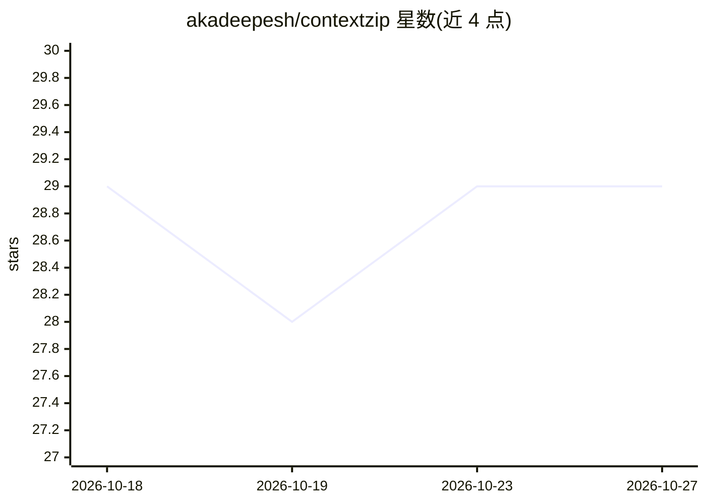

# akadeepesh/contextzip

⭐ 29 · Python · MIT · 推送 2026-10-26 · [GitHub](https://github.com/akadeepesh/contextzip) · [官网](https://contextzipcli.com) · 个人维护

**为 AI 编码工具打包代码库并将 AI 改动写回的 CLI**

面向使用 Claude/ChatGPT/Gemini 等工具的开发者：一条命令扫描项目，按标记文件识别技术栈，自动排除依赖、构建产物、缓存与 .gitignore 内容，默认剔除 .env、私钥、云凭据等敏感文件（有意包含时做值脱敏），生成 ZIP 并复制到剪贴板供粘贴上传。apply-zip 将 AI 返回的改动写回项目，基于本地快照做三版本对比，区分新增/合并/冲突等状态并支持 VS Code 三方合并。可直接打包 GitHub/GitLab/Bitbucket 仓库（无需克隆），支持浏览器端、VS Code 扩展与 MCP 服务器形态；--prompt 可用 Gemini API key 做自然语言文件筛选（默认 gemini-2.5-flash-lite，限流时回退本地关键词选择器）。

## 筛选速览

| 维度 | 判定 | 备注 |
|---|---|---|
| AI 角色 | `ai-ecosystem` | LLM/agent 周边工具 |
| 许可风险 | `permissive` | MIT |
| 部署形态 | `desktop` | 安装包/桌面程序 |
| 模型依赖 | — | README 未给出锁定关系 |
| 硬件要求 | — | 无带数字的原话,不猜 |
| 安装摩擦 | `low` | 无编译、无系统依赖或容器化 |
| 成熟度 | — | 结构信号不足 |

## 能力要点

- 按标记文件识别技术栈并自动排除依赖/构建产物/敏感文件（.env 值脱敏）
- apply-zip 基于本地快照做三版本对比，区分合并/冲突/漂移等 10 余种状态
- 免克隆打包 GitHub/GitLab/Bitbucket 仓库，并可 --pr 直接回传为 Pull Request
- 提供 CLI、VS Code 扩展、浏览器端与 MCP 服务器四种使用形态

## 适用场景

- 把代码库打包粘贴给 Claude/ChatGPT/Gemini 做编码辅助
- 把 AI 返回的改动安全写回项目并处理冲突
- 打包远程仓库或仅 git 变更部分交给 AI 做代码审查

## 场景标签

 · 领域:开发者工具/AI 编码辅助

## 证据(README 行号)

> L31: 4. **Puts the ZIP on your clipboard** as a real file, so you can paste it straight into Claude, ChatGPT, Gemini or 
> L179: ```bash

## 星数曲线



2026-10-18 29 → 2026-10-27 29（+0）


---
*卡片 v1 · prompt 1.4 · 生成 2026-10-26 · 置信度 high · 依据 README sha `eef9237999a2` · [字段定义](../../DATASET.md)*
