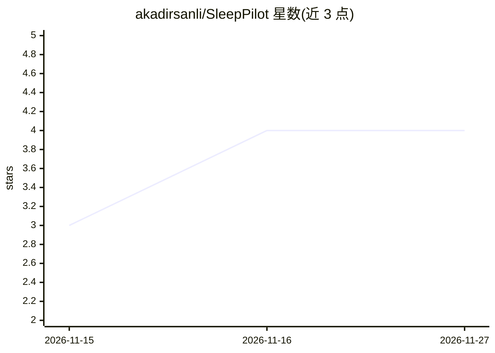

# akadirsanli/SleepPilot

⭐ 4 · JavaScript · MIT · 推送 2026-11-22 · [GitHub](https://github.com/akadirsanli/SleepPilot) · 个人维护

**夜间自主运行编码 agent 的本地监督器，以检查通过为准**

本地优先的监督工具：夜间接管用户已有的编码 agent（Claude Code、Codex、OpenCode、OpenAI 兼容 API、Ollama、自定义 CLI），按 Manager/Developer/Reviewer 分工派发任务，只有自身运行的检查通过才标记任务完成。支持分角色路由引擎与配额回退、手机 QR 码远程控制、崩溃与停顿看护、headless CI/cron 运行，以及把目标程序逆向为 Rust 实现的工作流。零运行时依赖，仅要求 Node.js 20.10+。

## 筛选速览

| 维度 | 判定 | 备注 |
|---|---|---|
| AI 角色 | `ai-ecosystem` | LLM/agent 周边工具 |
| 许可风险 | `permissive` | MIT |
| 部署形态 | `library` | 以包/库形式分发 |
| 模型依赖 | local-ok | 支持本地模型 |
| 硬件要求 | — | 无带数字的原话,不猜 |
| 安装摩擦 | `low` | 无编译、无系统依赖或容器化 |
| 成熟度 | — | 结构信号不足 |

## 能力要点

- 六种引擎接入：Claude Code、Codex CLI、OpenCode、API harness、DeepSeek Harness、自定义命令
- 证据式验证：命令检查、语法解析、无头浏览器冒烟、cargo test、file:line 引用核验
- 分角色路由与配额感知回退（Manager/Developer/Reviewer 各自可指定引擎与模型）
- 手机 QR 码远程控制与 Tailscale 私有访问

## 适用场景

- 晚上给 agent 布置任务，早上收到带验证结果的报告
- 多个模型/引擎按计划、编码、审查分工并用，配额耗尽自动切换
- 把 agent 接入 CI 或 cron 做无人值守长时间运行
- 对已授权的程序做逆向并重建为 Rust 实现

## 场景标签

`编码 Agent` · 领域:编码与开发

## 证据(README 行号)

> L7: A local-first supervisor that runs **Claude Code, Codex, OpenCode — or any CLI agent —**
> L25: **SleepPilot is the supervisor those agents never had.** It plans the work, hands
> L47: Six engine types, per-role routing, local AI via Ollama. No build step, no

## 星数曲线

2026-11-15 3 → 2026-11-27 4（+1）

---
*卡片 v1 · prompt 1.4 · 生成 2026-11-21 · 置信度 high · 依据 README sha `d84cea0961eb` · [字段定义](../../DATASET.md)*
