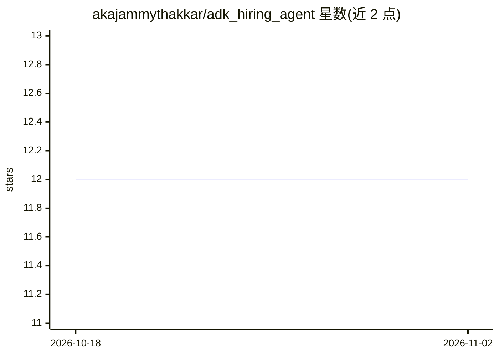

# akajammythakkar/adk_hiring_agent

⭐ 12 · Python · MIT · 推送 2025-12-21 · [GitHub](https://github.com/akajammythakkar/adk_hiring_agent) · [官网](https://akajammythakkar.stepwik.com/labs/building-a-hiring-agent-with-adk-gemini-3) · 个人维护

**教学 Codelab：用 Google ADK 与 Gemini 3 构建招聘多智能体**

一份 Codelab 教程，指导开发者基于 Google ADK（Agent Development Kit）与 Gemini 3 模型构建对话式技术候选人评估系统。系统包含 5 个专用 Agent（RubricBuilder、ResumeReviewer、GitHubValidator、GitHubReviewer、VerdictSynthesizer）与 1 个根编排器，通过 GitHub REST API 实时验证账号指标，按结构化评分框架从职位描述到 HIRE/NO HIRE 决策完成端到端流程。需 Python 3.8+、Google Cloud 账号与 Gemini API key，clone 仓库后 pip 安装依赖运行。

## 筛选速览

| 维度 | 判定 | 备注 |
|---|---|---|
| AI 角色 | `ai-knowledge` | 知识聚合/清单类 |
| 许可风险 | `permissive` | MIT |
| 部署形态 | `library` | 以包/库形式分发 |
| 模型依赖 | — | README 未给出锁定关系 |
| 硬件要求 | — | 无带数字的原话,不猜 |
| 安装摩擦 | `low` | 无编译、无系统依赖或容器化 |
| 成熟度 | — | 结构信号不足 |

## 能力要点

- 5 个专用 Agent 与 1 个根编排器的多智能体架构
- GitHub REST API 实时账号验证与指标获取
- 结构化评分框架输出 HIRE/NO HIRE 决策
- 覆盖提示工程、工具调用、状态管理等 ADK 概念

## 适用场景

- 学习用 Google ADK 构建多智能体协作系统
- 搭建自动化简历评估与候选人筛选流程
- 练习 Agent 工具调用与外部 API 集成

## 场景标签

`教程课程` `多智能体` · 领域:Agent 开发

## 证据(README 行号)

> L3: Welcome to the Codelab for building an **AI-Powered Conversational Hiring Agent System** using Google's ADK (Agent D
> L13: This Codelab teaches you how to build a sophisticated multi-agent system that automates technical candidate evaluat

## 星数曲线

2026-10-18 12 → 2026-11-02 12（+0）

---
*卡片 v1 · prompt 1.4 · 生成 2026-11-01 · 置信度 high · 依据 README sha `746970caf9e9` · [字段定义](../../DATASET.md)*
