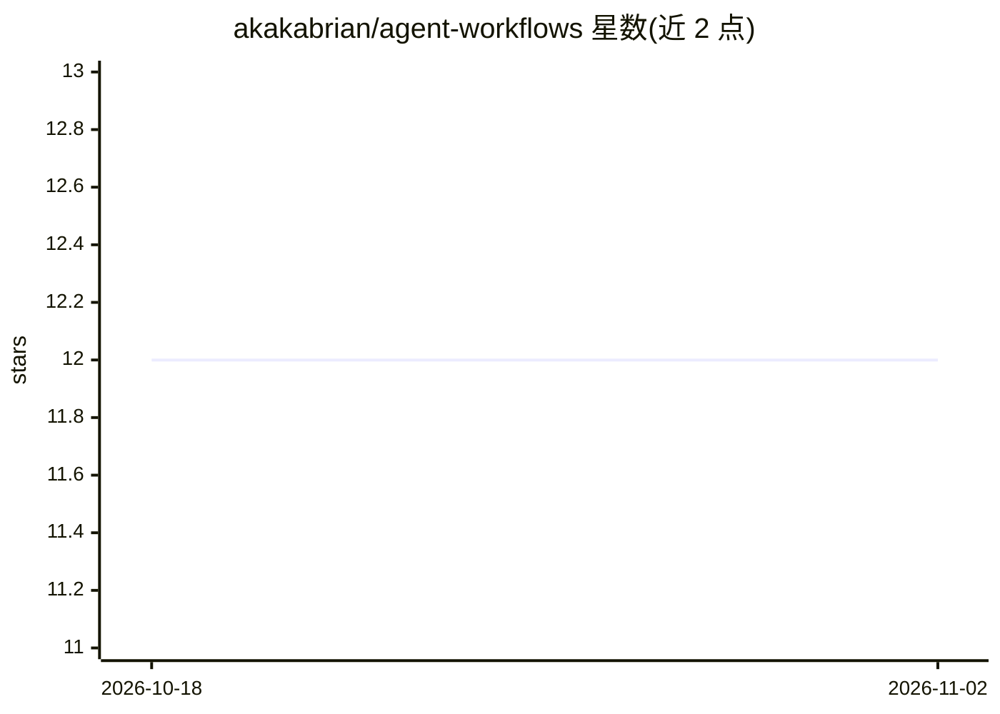

# akakabrian/agent-workflows

⭐ 12 · Python · MIT · 推送 2026-11-01 · [GitHub](https://github.com/akakabrian/agent-workflows) · 个人维护

**零依赖的 Python 动态 agent 工作流运行时，可中断恢复**

仅用 Python 标准库实现的工作流编排运行时：工作流是含 async def main 的普通 .py 脚本，提供 agent 调用、parallel 扇出、pipeline、schema 校验、token/成本预算等原语；每次运行记录在 SQLite，owf resume 可恢复中断的运行并重放缓存的只读调用。适配器覆盖离线 fake、Claude/Codex 本地 CLI 与 OpenAI/Anthropic/Gemini/DeepSeek/OpenRouter HTTP API，另提供 stdlib-only 的 MCP server 供 Claude Code 等 agent 调用。需 Python 3.11+，无其他运行时依赖，PyPI 包尚未发布，从源码安装。

## 筛选速览

| 维度 | 判定 | 备注 |
|---|---|---|
| AI 角色 | `ai-ecosystem` | LLM/agent 周边工具 |
| 许可风险 | `permissive` | MIT |
| 部署形态 | `library` | 以包/库形式分发 |
| 模型依赖 | local-ok | 支持本地模型 |
| 硬件要求 | — | 无带数字的原话,不猜 |
| 安装摩擦 | `low` | 无编译、无系统依赖或容器化 |
| 成熟度 | — | 结构信号不足 |

## 能力要点

- 标准库零依赖实现，工作流即普通 .py 脚本
- SQLite 运行日志，中断后 resume 并重放缓存调用
- fake 离线适配器可在无模型环境下运行全流程
- 提供 MCP server（13 个工具）与 CLI 双入口

## 适用场景

- 编写可扇出、可校验、可预算的多模型调用工作流
- 在断点处恢复失败的长任务运行
- 让 Claude Code 等 MCP 客户端以工具方式运行与检查工作流

## 场景标签

`工作流自动化` `Agent 框架` · 领域:Agent 开发

## 证据(README 行号)

> L3: A zero-dependency, stdlib-only Python runtime for **provider-agnostic dynamic
> L4: agent workflows** — durable, resumable, and composable from a single script
> L271: Open Agent Workflows ships three kinds of provider, all standard-library only:

## 星数曲线

2026-10-18 12 → 2026-11-02 12（+0）

---
*卡片 v1 · prompt 1.4 · 生成 2026-11-01 · 置信度 mid · 依据 README sha `c41fa7dc9cb1` · [字段定义](../../DATASET.md)*
