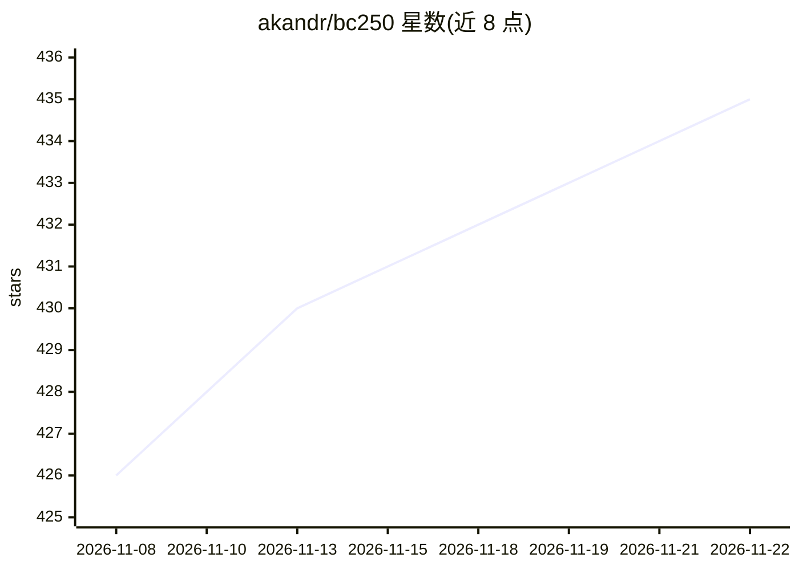

# akandr/bc250

⭐ 435 · Python · NOASSERTION · 推送 2026-09-13 · [GitHub](https://github.com/akandr/bc250) · 个人维护

**AMD BC-250（PS5 同源 APU）本地 LLM 家用服务器搭建指南**

将 AMD BC-250 矿机板（Zen 2 + GFX1013、16 GB 统一内存）改造为无头 AI 服务器的完整文档：覆盖驱动与计算栈选型（Vulkan 为可用路径，ROCm 需打补丁内核）、GTT/TTM 内存调优、社区 40-CU 解锁补丁的 A/B 基准、31 个模型的推理性能与质量评测、基于 Signal 的聊天/视觉/转录机器人、stable-diffusion.cpp 图像生成及 330 个自主任务的监控生态。代码 AGPL v3，文档 CC BY-SA 4.0，附方法论论文与原始数据存档。

## 筛选速览

| 维度 | 判定 | 备注 |
|---|---|---|
| AI 角色 | `ai-knowledge` | 知识聚合/清单类 |
| 许可风险 | `none` | NOASSERTION |
| 部署形态 | `None` |  |
| 模型依赖 | local-ok | 支持本地模型 |
| 硬件要求 | — | 无带数字的原话,不猜 |
| 安装摩擦 | `high` | 编译与系统依赖俱全 |
| 成熟度 | — | 结构信号不足 |

## 能力要点

- Vulkan 推理路径 + GTT/TTM 内存调优使 14B 模型可运行
- 40-CU 解锁补丁带来生成中位 1.32×、预填 1.50× 提速（11 模型 A/B）
- 31 模型基准与 64K 长上下文、5 针检索质量评估
- Signal 聊天机器人（对话/视觉/转录）与图像生成流水线

## 适用场景

- 把手中的 BC-250 矿机板改造成本地 LLM 推理服务器
- 查阅 GFX1013 硬件上各量化模型的实测性能数据
- 搭建带聊天机器人和图像生成的家用 AI 服务器

## 场景标签

`推理引擎` `模型评测` `聊天机器人` `图像生成` · 领域:对话与助手

## 证据(README 行号)

> L21: > A complete guide to running large language models on the AMD BC-250 — a crypto-mining board built around AMD's Cy
> L23: > This document covers everything found so far: the hardware, the software stack, all benchmark data including thin

## 星数曲线

2026-11-08 426 → 2026-11-22 435（+9）

---
*卡片 v1 · prompt 1.4 · 生成 2026-11-17 · 置信度 high · 依据 README sha `ac9e9b41506c` · [字段定义](../../DATASET.md)*
