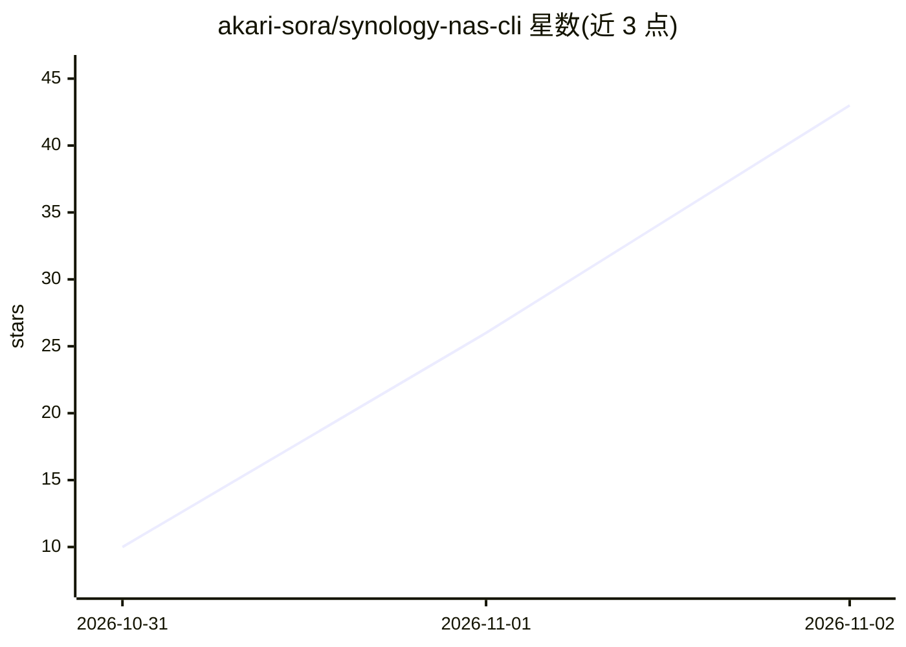

# akari-sora/synology-nas-cli

⭐ 43 · Python · MIT · 推送 2026-11-01 · [GitHub](https://github.com/akari-sora/synology-nas-cli) · [官网](https://gitlab.com/aa22396584/synology-nas-cli) · 个人维护 · 中文 README

**Synology DSM 7 的零依赖 Python CLI + MCP 服务器：一键审计修复勒索暴露面**

纯标准库实现的 `nas` 命令行工具与 stdio MCP 服务器，通过 DSM 7 Web API 读取状态、健康、日志、卷、包、Tailscale 与升级信息。核心是针对 C3RB3R / .L0CK3D 勒索活动的只读审计（`nas incident`，逐项输出 PASS/WARN/FAIL）与带 dry-run 计划的修复（`nas incident fix`，按顺序应用并回读验证），另有 10 分钟健康监控推送 webhook。README 提供提示词将工具交给 Claude Code、Cursor 等 AI agent 按运行手册执行。GitLab 为正式仓库，GitHub 为镜像。

## 筛选速览

| 维度 | 判定 | 备注 |
|---|---|---|
| AI 角色 | `ai-enhanced` | 去掉 AI 部分产品仍成立 |
| 许可风险 | `permissive` | MIT |
| 部署形态 | `desktop` | 安装包/桌面程序 |
| 模型依赖 | — | README 未给出锁定关系 |
| 硬件要求 | — | 无带数字的原话,不猜 |
| 安装摩擦 | `low` | 无编译、无系统依赖或容器化 |
| 成熟度 | — | 结构信号不足 |

## 能力要点

- 只读审计 15+ 安全项：DSM 版本、SA-26:14 漏洞包、防火墙、QuickConnect、外部登录、SMB1、勒索信与 CVE-2024-10441 利用痕迹
- fix 命令先 dry-run 展示 before→after 计划，按固定顺序应用并回读验证
- 零依赖（Python 3.8+ 标准库），可直接在 DSM 本机运行
- 同时作为 stdio MCP 服务器供 tool-using AI agent 调用

## 适用场景

- 互联网暴露的 Synology NAS 勒索事件后审计与加固
- 让 AI agent 按运行手册代为执行 setup/doctor/incident 流程
- 定时健康与安全监控并推送 webhook

## 场景标签

`网络安全` · 领域:学习与行业

## 证据(README 行号)

> L13: `nas` is a zero-dependency Python CLI (standard library only, Python 3.8+, so it also runs on DSM itself) and stdio
> L21: Paste either prompt into Claude Code, Codex, Cursor, Gemini CLI, OpenCode, Grok Bot, or any tool-using AI agent (Gr

## 星数曲线

2026-10-31 10 → 2026-11-02 43（+33）

---
*卡片 v1 · prompt 1.4 · 生成 2026-10-31 · 置信度 mid · 依据 README sha `8dea6ecaee4c` · [字段定义](../../DATASET.md)*
