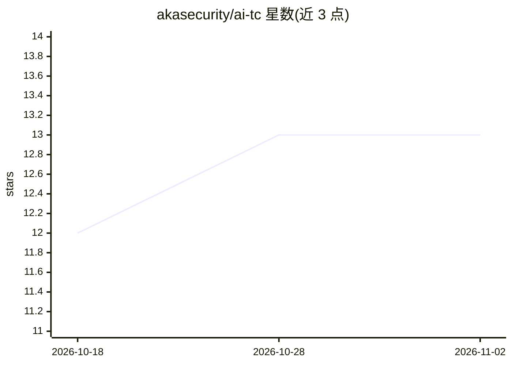

# akasecurity/ai-tc

⭐ 13 · TypeScript · Apache-2.0 · 推送 2026-11-01 · [GitHub](https://github.com/akasecurity/ai-tc) · [官网](https://akasecurity.io) · 组织维护

**给 AI agent 会话加安全闸门的本地策略引擎，拦截敏感数据与高危命令**

AI Traffic Control 是 AKA Security 开源的 agent harness 安全防护层：以插件形式接入 Claude Code / Claude Desktop，在提示词、工具调用、响应与文件读取生效前经过单一策略引擎扫描。检测以正则为主，辅以 Luhn 校验、香农熵校验，覆盖密钥、PCI 卡号、PHI/PII 与高危命令；每次匹配产生 finding，策略决定五种结果（monitor/warn/redact/block/exception）。数据保存在本地 SQLite（~/.aka/data/aka.db），检测与执行默认不外发数据。限制：检测主要靠正则形状匹配，非默认全量脱敏；Windows 下无静态权限控制。

## 筛选速览

| 维度 | 判定 | 备注 |
|---|---|---|
| AI 角色 | `ai-ecosystem` | LLM/agent 周边工具 |
| 许可风险 | `permissive` | Apache-2.0 |
| 部署形态 | `library` | 以包/库形式分发 |
| 模型依赖 | locked-api |  |
| 硬件要求 | — | 无带数字的原话,不猜 |
| 安装摩擦 | `low` | 无编译、无系统依赖或容器化 |
| 成熟度 | — | 结构信号不足 |

## 能力要点

- 五级策略结果：monitor / warn / redact / block / exception，可按规则或类别在 dashboard 调整
- 内置检测：AWS 密钥形状、Luhn 校验卡号、IBAN、ICD-10、SSN、rm -rf 等高危命令
- 本地 SQLite 存储会话日志，检测与执行不向模型或第三方发送数据
- 提供独立 aka CLI（dashboard、本地存储、aka scan），二进制内嵌运行时无需 Node.js

## 适用场景

- 在 Claude Code / Claude Desktop 会话中拦截密钥与 PII 泄露
- 阻止 curl 管道执行、force push、rm -rf 等高危命令
- 对 agent 会话留存本地审计日志并按需授予例外

## 场景标签

`网络安全` · 领域:学习与行业

## 证据(README 行号)

> L10:  Every event in an agent session runs through one control point before it takes effect.
> L12:  Prompts, tool calls, responses and file reads, scanned against your rule packs on your machine. Open source, by AK
> L118: Every event in a session runs through one control point before it takes effect:

## 星数曲线

2026-10-18 12 → 2026-11-02 13（+1）

---
*卡片 v1 · prompt 1.4 · 生成 2026-10-31 · 置信度 high · 依据 README sha `3bf0e930aaf3` · [字段定义](../../DATASET.md)*
