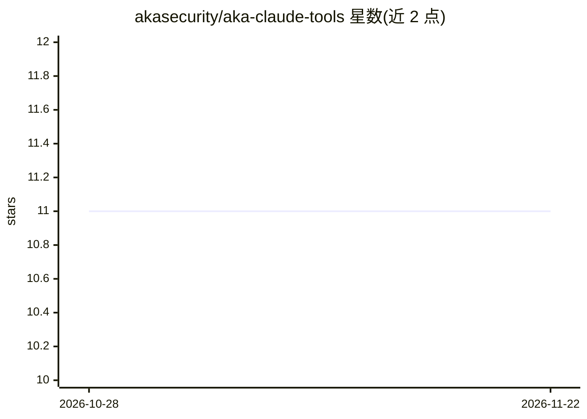

# akasecurity/aka-claude-tools

⭐ 11 · Shell · MIT · 推送 2026-11-05 · [GitHub](https://github.com/akasecurity/aka-claude-tools) · [官网](https://akasecurity.github.io) · 组织维护

**为 Claude Code 提供安全加固配置的 CLI 工具集**

AKA Security 出品的 Claude Code 安全加固套件：通过独立隔离的 profile 为编码 agent 添加默认安全护栏，包括拒绝读取凭证文件、阻断 curl|bash 与 shell 启动文件编辑、出站密钥泄露扫描、模型上下文前的密钥脱敏与提示注入短语标记、命令输出压缩摘要等。共 19 个组件，11 个默认启用、8 个可自选，以 shell 与 TypeScript 实现，本地扫描、不上传数据。支持 npm/Homebrew/源码及 Claude Code 插件两种安装路径，插件形态不含完整 kit 的部分功能。

## 筛选速览

| 维度 | 判定 | 备注 |
|---|---|---|
| AI 角色 | `ai-ecosystem` | LLM/agent 周边工具 |
| 许可风险 | `permissive` | MIT |
| 部署形态 | `library` | 以包/库形式分发 |
| 模型依赖 | — | README 未给出锁定关系 |
| 硬件要求 | — | 无带数字的原话,不猜 |
| 安装摩擦 | `low` | 无编译、无系统依赖或容器化 |
| 成熟度 | — | 结构信号不足 |

## 能力要点

- 19 个可独立选用的安全组件，11 个默认启用
- leak-guard/command-guard 本地扫描出站内容与命令，密钥形态匹配并阻断
- post-guard 在模型看到返回内容前脱敏密钥并标记提示注入短语
- 安装器交互式迁移现有配置，提供 --audit 检查变更

## 适用场景

- 让 AI 编码 agent 无法读取我的 SSH 密钥、.env 等凭证文件
- 阻止 agent 执行 curl 管道 bash 或把密钥发到网络
- 在隔离 profile 中安全试用新配置，保留原有设置

## 场景标签

`网络安全` · 领域:学习与行业

## 证据(README 行号)

> L14: **Make Claude Code safer to use.** Clean context, locked-down credentials, guarded
> L42: Nineteen small pieces, eleven on by default and eight opt-in. Each stands alone. Take what you want.
> L102: `claude plugin marketplace add akasecurity/marketplace` then `claude plugin install aka-claude-tools@akasecurity` 

## 星数曲线

2026-10-28 11 → 2026-11-22 11（+0）

---
*卡片 v1 · prompt 1.4 · 生成 2026-11-18 · 置信度 high · 依据 README sha `4567173cdfd6` · [字段定义](../../DATASET.md)*
