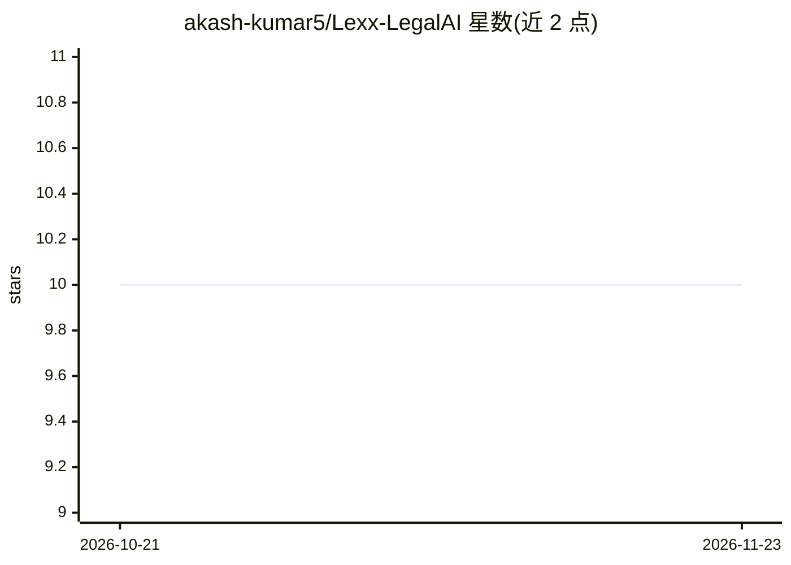

# akash-kumar5/Lexx-LegalAI

⭐ 10 · TypeScript · 推送 2025-12-25 · [GitHub](https://github.com/akash-kumar5/Lexx-LegalAI) · [官网](https://lexi-weld-zeta.vercel.app) · 个人维护

**面向印度法律的 RAG 法律问答与文书起草助手**

基于 LLM+RAG 的印度法律 AI 助手：从策划的法律知识库检索相关条款，生成带 Act 引用的上下文回答，并根据用户输入的关键信息自动生成结构化法律文书草稿、可导出 PDF。支持多会话线程与基于提示词的起草界面。技术栈为 Next.js 前端、FastAPI 后端、MongoDB 数据库，RAG 使用 SentenceTransformers 与 ChromaDB，经 OpenRouter API 调用模型。README 说明为个人 proof-of-work 项目，文档起草相关部分标注为进行中。

## 筛选速览

| 维度 | 判定 | 备注 |
|---|---|---|
| AI 角色 | `ai-native` | 本体是模型或模型工具 |
| 许可风险 | `none` | — |
| 部署形态 | `None` |  |
| 模型依赖 | locked-api |  |
| 硬件要求 | — | 无带数字的原话,不猜 |
| 安装摩擦 | `low` | 无编译、无系统依赖或容器化 |
| 成熟度 | `idea` | |

## 能力要点

- RAG 检索策划法律知识库并自动引用相关印度 Act
- 按提示词输入生成结构化文书草稿并导出 PDF
- 多会话线程支持
- SentenceTransformers + ChromaDB 构建检索层

## 适用场景

- 就印度法律条文提问并获取带出处的回答
- 根据案情要点生成法律文书草稿
- 分别管理多个法律咨询会话

## 场景标签

`RAG` `文档问答` `AI 写作` `AI 助手` · 领域:对话与助手

## 证据(README 行号)

> L2: Lexx is an LLM + RAG–powered legal AI built for Indian laws.
> L10: - RAG-Powered Context Retrieval – Pulls relevant legal references from a curated knowledge base.
> L71: - AI: OpenRouter API + SentenceTransformers + ChromaDB (RAG)

## 星数曲线

2026-10-21 10 → 2026-11-23 10（+0）

---
*卡片 v1 · prompt 1.4 · 生成 2026-11-20 · 置信度 high · 依据 README sha `37e94986b97c` · [字段定义](../../DATASET.md)*
