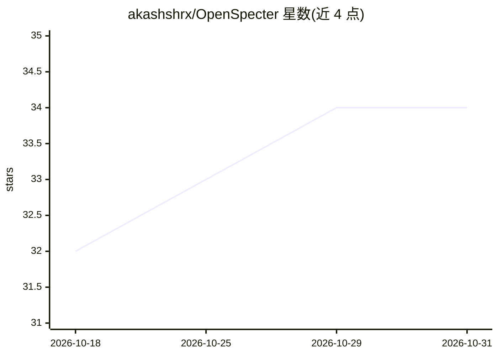

# akashshrx/OpenSpecter

⭐ 34 · TypeScript · AGPL-3.0 · 推送 2026-09-12 · [GitHub](https://github.com/akashshrx/OpenSpecter) · [官网](https://www.openspecter.com/) · 组织维护

**面向法律团队的开源自托管 AI 工作区**

由 Quantera.ai 维护的法律团队 AI 工作区，自托管部署。功能包括按案件/客户组织项目、文档上传与版本管理、带引用的问答与摘要助手对话、批量文档结构化数据抽取为审阅表、可复用的提示链工作流，以及浏览器原生语音输入。技术栈为 Next.js/React/TypeScript 前端、Express 后端、Supabase（PostgreSQL + 行级安全）数据库与认证、Cloudflare R2/S3 存储可选；AI 提供商支持 Gemini、Anthropic 及 OpenRouter 兼容模型，法律检索接入 LegalDataHunter（178 司法辖区）与 Vaquill。系 Mike (willchen96/mike) 的 fork，AGPL-3.0 许可。需 Node.js 20+ 与 Yarn，通过 yarn 安装并以 dev 命令本地运行。

## 筛选速览

| 维度 | 判定 | 备注 |
|---|---|---|
| AI 角色 | `ai-native` | 本体是模型或模型工具 |
| 许可风险 | `viral` | AGPL-3.0 |
| 部署形态 | `None` |  |
| 模型依赖 | locked-api |  |
| 硬件要求 | — | 无带数字的原话,不猜 |
| 安装摩擦 | `low` | 无编译、无系统依赖或容器化 |
| 成熟度 | — | 结构信号不足 |

## 能力要点

- 带引用的法律文档问答、摘要与起草助手
- Tabular Reviews 批量抽取文档结构化数据为审阅表
- LegalDataHunter 覆盖 178 司法辖区的判例与法规检索
- Supabase 行级安全 + 访客模式与孤儿账号 7 天清理

## 适用场景

- 按案件/客户组织文档并让 AI 辅助审阅
- 批量抽取合同等文档中的结构化数据生成审阅表
- 复用提示链模板自动化重复性法律流程

## 场景标签

`文档问答` · 领域:知识与检索

## 证据(README 行号)

> L3: Open Specter is an open-source AI workspace for legal teams. Organize matters, review documents, run AI conversation
> L13: - **Assistant Chat** — Question answering, summarization, drafting, and citations over selected context.
> L29: |AI Providers|Gemini, Anthropic, OpenRouter-compatible models|

## 星数曲线

2026-10-18 32 → 2026-10-31 34（+2）

---
*卡片 v1 · prompt 1.4 · 生成 2026-10-25 · 置信度 high · 依据 README sha `e253661eb290` · [字段定义](../../DATASET.md)*
