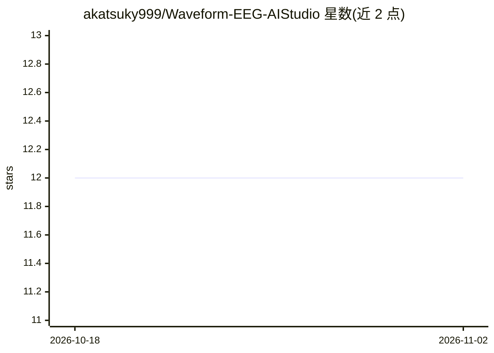

# akatsuky999/Waveform-EEG-AIStudio

⭐ 12 · JavaScript · Apache-2.0 · 推送 2026-09-22 · [GitHub](https://github.com/akatsuky999/Waveform-EEG-AIStudio) · 个人维护

**本地 EEG/iEEG 工作区：浏览、标注、分析信号并可选 AI 代理**

面向脑电研究者的本地信号工作区：浏览器内查看器支持时间、通道、蒙太奇、滤波、事件与导出控制，可读取 HDF5 与 EDF/EDF+/BDF 格式，提供相似波形检索与标注管理。内置可选的 EEG-Master 工具调用代理，需用户自行配置 OpenAI 兼容 API（Base URL、key、模型），代理基于当前查看器状态检索信号、本地运行 Python、调整视图并生成带证据的报告。声明非医疗器械，结论需人工审核；run_python 非加固沙箱。

## 筛选速览

| 维度 | 判定 | 备注 |
|---|---|---|
| AI 角色 | `ai-enhanced` | 去掉 AI 部分产品仍成立 |
| 许可风险 | `permissive` | Apache-2.0 |
| 部署形态 | `None` |  |
| 模型依赖 | — | README 未给出锁定关系 |
| 硬件要求 | — | 无带数字的原话,不猜 |
| 安装摩擦 | `low` | 无编译、无系统依赖或容器化 |
| 成熟度 | — | 结构信号不足 |

## 能力要点

- 浏览器内多通道 EEG/iEEG 查看器：滤波、蒙太奇、时间窗、事件、导出
- 支持 HDF5 与 EDF/EDF+/BDF 格式读取
- EEG-Master 代理可调用工具、本地运行 Python 并生成证据图像
- 相似波形检索（0.02–10 秒参考段）

## 适用场景

- 浏览、清洗、标注并导出长时间多通道脑电记录
- 让 AI 代理基于当前查看状态执行信号分析与形态复查
- 在一段信号中查找与参考段相似的其他片段

## 场景标签

`科研工具` `语义搜索` · 领域:知识与检索

## 证据(README 行号)

> L8: Agent: optional
> L44: - **EEG AI Agent.** EEG-Master works from the current Viewer state to search signals,
> L89: Open **EEG-Master → Config** and enter an API Base URL, API key, and model. Nothing is

## 星数曲线

2026-10-18 12 → 2026-11-02 12（+0）

---
*卡片 v1 · prompt 1.4 · 生成 2026-11-01 · 置信度 high · 依据 README sha `16c4e8bb0f89` · [字段定义](../../DATASET.md)*
