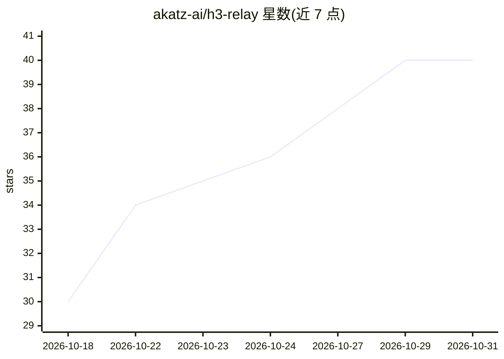

# akatz-ai/h3-relay

⭐ 40 · Python · GPL-3.0 · 推送 2026-10-22 · [GitHub](https://github.com/akatz-ai/h3-relay) · 组织维护

**ComfyUI 节点包：分阶段、可恢复的 MiniMax H3 视频工作流**

面向 ComfyUI 的自定义节点集合，围绕 MiniMax H3 视频生成组织可操控、可恢复、内存受限的长序列工作流：将素材准备、窗口规划、镜头生成、审阅检查点、LTX/H3 Ultimate 2 倍增强、RIFE 插帧与最终装配拆分为独立节点。核心机制是分阶段执行——依赖顺序由可见图推导，已接受镜头从磁盘完整性清单恢复，模型在任务间卸载，内存需求只随单个活跃镜头而非镜头总数增长。改动某镜头只使其下游精加工失效，缓存按内容寻址。限定条件：目标环境为 ComfyUI 0.37.0+、Linux 与 RTX 4090（24GB），FastH3 实验路径需额外 wheel 且 Windows GPU 推理未验证。

## 筛选速览

| 维度 | 判定 | 备注 |
|---|---|---|
| AI 角色 | `ai-ecosystem` | LLM/agent 周边工具 |
| 许可风险 | `viral` | GPL-3.0 |
| 部署形态 | `None` |  |
| 模型依赖 | — | README 未给出锁定关系 |
| 硬件要求 | — | 无带数字的原话,不猜 |
| 安装摩擦 | `medium` | 含编译或系统依赖之一 |
| 成熟度 | `idea` | |

## 能力要点

- 分阶段有界内存执行：恢复已接受镜头、任务间卸载模型，内存不随镜头数增长
- native H3 生成与 LTX/H3 Ultimate 增强、插帧分离，可在付费精加工前审阅镜头
- 内容寻址磁盘缓存：重跑未变输入直接返回已接受产物，仅失效受影响派生结果
- 约 16 个节点覆盖模型加载、LoRA、注意力后端、序列生成、增强、插帧与装配

## 适用场景

- 在 ComfyUI 中生成并逐镜头审阅长序列 H3 视频
- 先出 native 480p 草稿，确认后再跑 LTX 或 Ultimate 2 倍增强
- 受限显存（24GB）下完成多镜头视频的增强与插帧精加工

## 场景标签

`视频生成` · 领域:内容生成

## 证据(README 行号)

> L3: H3 Relay provides steerable, resumable MiniMax H3 shot generation for ComfyUI.
> L10: The reusable toolkit exposes source preparation, window planning, history,
> L11: mask conversion, assembly and durable review as separate nodes. ComfyUI's

## 星数曲线

2026-10-18 30 → 2026-10-31 40（+10）

---
*卡片 v1 · prompt 1.4 · 生成 2026-10-25 · 置信度 high · 依据 README sha `32c8ec56a644` · [字段定义](../../DATASET.md)*
