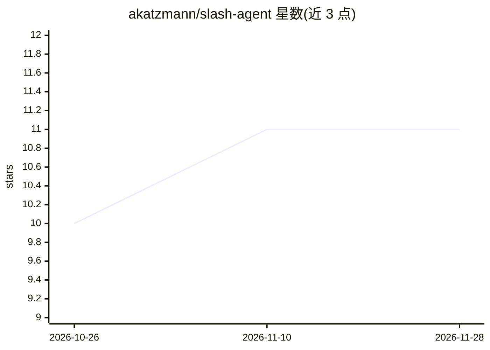

# akatzmann/slash-agent

⭐ 11 · Python · Apache-2.0 · 推送 2026-11-26 · [GitHub](https://github.com/akatzmann/slash-agent) · 个人维护

**终端 Bash 内置的按需 LLM 编码助手**

以 shell 函数形式集成进 Bash/Zsh/Fish 的命令行 AI 助手：平时完全休眠、不占内存，输入 /agent 激活后读取 tmux 回显或 shell 历史末 50–100 行作为上下文，让 LLM 诊断报错并提出修复命令；命令经 PTY 交互执行，默认逐条需用户 y/n/e/c 确认，cd 与 export 会同步回父 shell。后端默认 Ollama，亦可配置 OpenAI/Azure 或 OpenAI 兼容本地服务；仅支持 PTY 环境，Windows 需 WSL2。

## 筛选速览

| 维度 | 判定 | 备注 |
|---|---|---|
| AI 角色 | `ai-native` | 本体是模型或模型工具 |
| 许可风险 | `permissive` | Apache-2.0 |
| 部署形态 | `self-host` | docker 或自建部署 |
| 模型依赖 | local-ok | 支持本地模型 |
| 硬件要求 | — | 无带数字的原话,不猜 |
| 安装摩擦 | `low` | 无编译、无系统依赖或容器化 |
| 成熟度 | — | 结构信号不足 |

## 能力要点

- 零开销按需激活：休眠时 0MB 内存，无常驻守护进程
- 读取 tmux scrollback/shell 历史自动捕获报错上下文
- PTY 交互执行与 y/n/e/c 可调控确认循环
- cd/export 状态经 sourcing 脚本同步回父 shell

## 适用场景

- 构建或测试报错时一键让 agent 读日志并给修复命令
- 让 agent 读取依赖导入错误并安装包验证构建
- 快速生成脚本、配置 systemd/数据库等系统环境
- 通过本地 Ollama 离线使用，终端数据不出机器

## 场景标签

`AI 助手` · 领域:对话与助手

## 证据(README 行号)

> L10: **slash-agent** is a zero-overhead, dormant AI coding partner integrated natively into your active Bash shell. Simp
> L12: * 🖥️ **Terminal Context Capture:** Instantly reads recent `tmux` scrollback or shell history to diagnose errors wit
> L77: * **🔍 Context-Aware Diagnoses:** Instantly extracts the last 50 lines of your active `tmux` pane or terminal histor

## 星数曲线

2026-10-26 10 → 2026-11-28 11（+1）

---
*卡片 v1 · prompt 1.4 · 生成 2026-11-18 · 置信度 mid · 依据 README sha `1cc14f711be8` · [字段定义](../../DATASET.md)*
