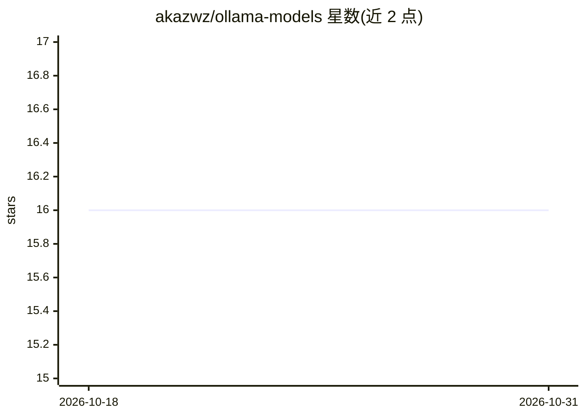

# akazwz/ollama-models

⭐ 16 · TypeScript · MIT · 推送 2026-10-06 · [GitHub](https://github.com/akazwz/ollama-models) · [官网](https://ollama-models.zwz.workers.dev) · 个人维护

**每日自动抓取 Ollama 模型库的免费 JSON 目录 API**

因 Ollama 官方没有公开浏览模型库的端点，本项目用 Cloudflare Worker 每日定时抓取 ollama.com 库页面与各模型标签页，把 240+ 模型与 7,400+ 标签写入 Workers KV，通过单一 GET 端点以 JSON 数组返回，无需 key 与注册，开放 CORS。提供更新时间与过期状态响应头，更新失败时保留上一份目录。给需要模型选择器或标签自动补全的工具开发者用；自建需 Cloudflare Workers 付费计划与 Node.js 22.18+、pnpm。

## 筛选速览

| 维度 | 判定 | 备注 |
|---|---|---|
| AI 角色 | `ai-knowledge` | 知识聚合/清单类 |
| 许可风险 | `permissive` | MIT |
| 部署形态 | `library` | 以包/库形式分发 |
| 模型依赖 | local-ok | 支持本地模型 |
| 硬件要求 | — | 无带数字的原话,不猜 |
| 安装摩擦 | `low` | 无编译、无系统依赖或容器化 |
| 成熟度 | — | 结构信号不足 |

## 能力要点

- 单一 GET 端点返回全量模型目录，无需 key、开放 CORS
- 每日 00:00 UTC 由 Cron Trigger 重建，240+ 模型与 7,400+ 标签
- X-Catalog-Updated-At / X-Catalog-Stale 响应头标示数据新鲜度
- 更新失败保留上一份目录，单模型失败不阻塞其余更新

## 适用场景

- 为工具的模型选择器或标签自动补全提供数据源
- 免自建爬虫直接获取 ollama pull 可用的 name:tag 列表
- 自建一份该目录 API 用于生产依赖

## 场景标签

`网页抓取` · 领域:效率与自动化

## 证据(README 行号)

> L6: A free JSON API listing every model in the Ollama library with its description and all of its tags, refreshed daily.
> L8: Ollama has no public endpoint for browsing the library, so tools that want a model picker or tag autocomplete have t

## 星数曲线

2026-10-18 16 → 2026-10-31 16（+0）

---
*卡片 v1 · prompt 1.4 · 生成 2026-10-30 · 置信度 mid · 依据 README sha `afe619a581e8` · [字段定义](../../DATASET.md)*
