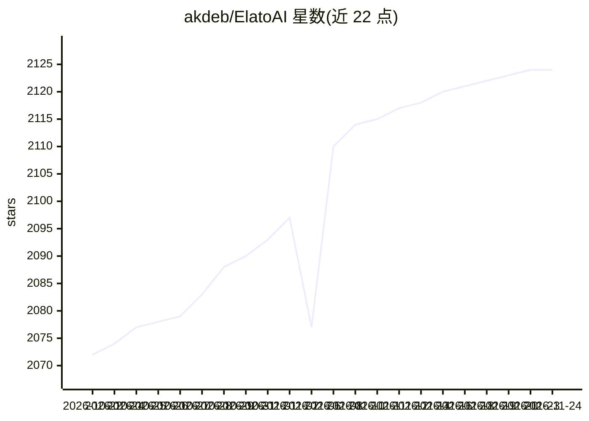

# akdeb/ElatoAI

⭐ 2,124 · TypeScript · NOASSERTION · 推送 2026-11-23 · [GitHub](https://github.com/akdeb/ElatoAI) · [官网](https://www.elatoai.com) · 组织维护 · 中文 README

**在 ESP32 硬件上运行实时语音 AI 的全栈方案，面向 AI 玩具/陪伴设备**

ElatoAI 由前端（Next.js）、边缘函数（Deno Edge 或 Cloudflare Workers）与 ESP32 IoT 客户端三部分组成，在 ESP32 上实现实时语音对话：支持 OpenAI Realtime、Gemini Live、Eleven Labs 等语音到语音 API，也可走 STT→LLM→TTS 流水线，经安全 WebSocket 传输，支持 20 分钟以上不间断对话。提供自定义 Agent、声音定制、OTA 固件更新、WiFi 配网等功能；局限包括 2-3 秒冷启动与 ESP32 端无语音打断检测。

## 筛选速览

| 维度 | 判定 | 备注 |
|---|---|---|
| AI 角色 | `ai-native` | 本体是模型或模型工具 |
| 许可风险 | `none` | NOASSERTION |
| 部署形态 | `None` |  |
| 模型依赖 | locked-api |  |
| 硬件要求 | — | 无带数字的原话,不猜 |
| 安装摩擦 | `low` | 无编译、无系统依赖或容器化 |
| 成熟度 | — | 结构信号不足 |

## 能力要点

- ESP32 通过安全 WebSocket 连接边缘函数，实现实时语音对话
- 支持 Deno Edge、Cloudflare Workers、FastAPI+Pipecat 三种部署路径，可接 100+ STT/LLM/TTS 模型
- 支持本地模型（Qwen、Mistral 等经 MLX）运行语音生成
- 提供 OTA 固件更新、设备管理认证、Web 端音量/音调控制

## 适用场景

- 制作能与 AI 对话的玩具或桌面陪伴设备
- DIY 一台可接入多种语音模型的 ESP32 语音终端
- 为语音硬件设备搭建带认证与设备管理的后台

## 场景标签

`语音 Agent` · 领域:对话与助手

## 证据(README 行号)

> L19: Realtime AI Speech powered by 100+ Voice AI models on ESP32, with Secure WebSockets & Edge Functions for >20-minute
> L93: ElatoAI consists of three main components:
> L96: 2. **Edge Server Functions** (`Deno Edge` or `Cloudflare Workers`) - to handle the websocket connections from the E

## 星数曲线

2026-10-22 2,072 → 2026-11-24 2,124（+52）

---
*卡片 v1 · prompt 1.4 · 生成 2026-11-24 · 置信度 high · 依据 README sha `b2a36b2bb811` · [字段定义](../../DATASET.md)*
