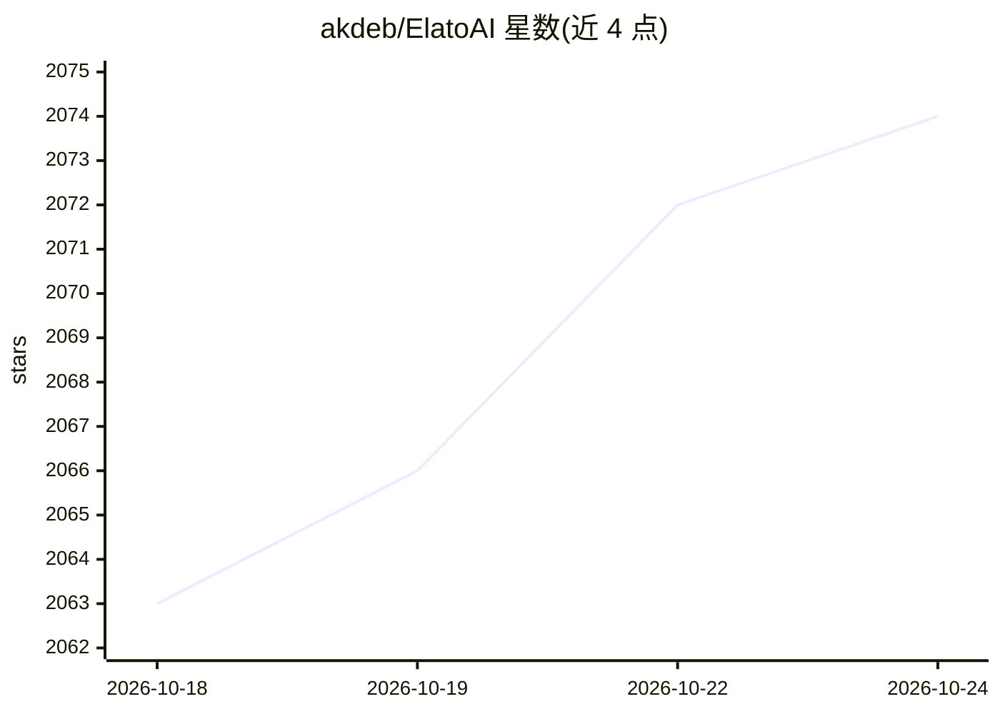

# akdeb/ElatoAI

⭐ 2,077 · TypeScript · NOASSERTION · 推送 2026-10-23 · [GitHub](https://github.com/akdeb/ElatoAI) · [官网](https://www.elatoai.com) · 个人维护

**在 ESP32 上搭建实时语音 AI 的开源全栈方案**

面向 AI 玩具与陪伴设备的实时语音 AI 项目：ESP32 固件经安全 WebSocket 连接 Deno Edge 或 Cloudflare Workers 边缘函数，接入 100+ 语音模型（OpenAI Realtime、Gemini Live、xAI Grok、ElevenLabs、Hume EVI-4 等），也可用 FastAPI + Pipecat 自建流水线，并支持 Qwen/Mistral 等本地模型。附带 Next.js 前端、设备管理与认证、OTA 更新。限制：2-3 秒冷启动、ESP32 无语音打断检测。

## 筛选速览

| 维度 | 判定 | 备注 |
|---|---|---|
| AI 角色 | `ai-native` | 本体是模型或模型工具 |
| 许可风险 | `none` | NOASSERTION |
| 部署形态 | `None` |  |
| 模型依赖 | locked-api |  |
| 硬件要求 | — | 无带数字的原话,不猜 |
| 安装摩擦 | `low` | 无编译、无系统依赖或容器化 |
| 成熟度 | — | 结构信号不足 |

## 能力要点

- 100+ STT/LLM/TTS 模型，五种语音到语音实时 API 通道
- Deno Edge / Cloudflare Workers 双边缘部署方案
- 支持 Qwen、Mistral 等本地模型与 TTS（MLX）
- 设备管理、OTA 更新、WiFi captive portal、OAuth 等 24 项功能

## 适用场景

- DIY 会说话的 AI 玩具或陪伴设备
- 搭建低延迟全球语音 AI 设备网络
- 为 ESP32 硬件项目接入多种语音模型流水线

## 场景标签

`语音 Agent` · 领域:对话与助手

## 证据(README 行号)

> L17: # 👾 ElatoAI: Realtime Voice AI Models on Arduino ESP32
> L19: Realtime AI Speech powered by 100+ Voice AI models on ESP32, with Secure WebSockets & Edge Functions for >20-minute
> L66: 1. **Realtime Speech-to-Speech**: Instant speech conversion powered by OpenAI's Realtime API, Gemini's Live API, xA

## 星数曲线

2026-10-18 2,063 → 2026-10-24 2,074（+11）

---
*卡片 v1 · prompt 1.4 · 生成 2026-10-21 · 置信度 high · 依据 README sha `8be86055a52b` · [字段定义](../../DATASET.md)*
