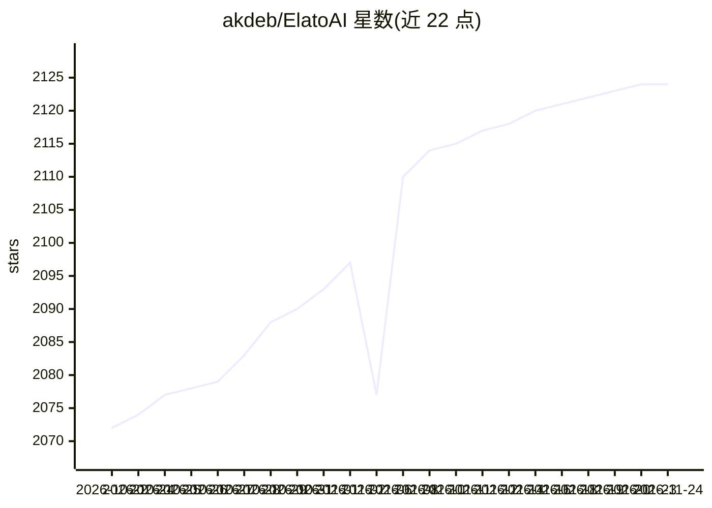

# akdeb/ElatoAI

⭐ 2,124 · TypeScript · NOASSERTION · 推送 2026-11-21 · [GitHub](https://github.com/akdeb/ElatoAI) · [官网](https://www.elatoai.com) · 组织维护 · 中文 README

**让 ESP32 硬件设备接入 100+ 语音 AI 模型实时对话**

面向 AI 玩具、桌面伴侣与 IoT 设备的实时语音 AI 项目，由三部分组成：Next.js 前端（Vercel 托管）、Deno Edge/Cloudflare Workers 边缘函数（处理 WebSocket 与 LLM API 调用）、ESP32 Arduino/PlatformIO IoT 客户端。支持 OpenAI Realtime、Gemini Live、xAI Grok 等 6 个边缘语音 API，以及 Cloudflare Workers 上 80+ LLM、10+ TTS、5 个 STT 模型组合，还可通过 FastAPI/Pipecat 自建语音管线；支持 MLX 本地模型。功能含服务器端 VAD、Opus 压缩、OTA 固件升级、设备管理与工具调用；无需 PSRAM，实测连续对话最长 17 分钟，冷启动 2-3 秒。

## 筛选速览

| 维度 | 判定 | 备注 |
|---|---|---|
| AI 角色 | `ai-ecosystem` | LLM/agent 周边工具 |
| 许可风险 | `none` | NOASSERTION |
| 部署形态 | `None` |  |
| 模型依赖 | locked-api |  |
| 硬件要求 | — | 无带数字的原话,不猜 |
| 安装摩擦 | `low` | 无编译、无系统依赖或容器化 |
| 成熟度 | — | 结构信号不足 |

## 能力要点

- Deno Edge/Cloudflare Workers 双边缘路径接入 100+ STT/LLM/TTS 模型
- ESP32-S3 客户端无需 PSRAM，支持 OTA 升级与触摸/按键控制
- Secure WebSockets 传输、AES-256 API Key 加密、Postgres RLS
- 支持 MLX 本地运行 Qwen、Mistral 等本地 LLM/TTS

## 适用场景

- 给 DIY AI 玩具或桌面伴侣加上实时语音对话能力
- 搭建可全球低延迟访问的语音 AI 设备服务
- 用 FastAPI/Pipecat 自定义 STT-LLM-TTS 语音管线
- 通过手机网页端管理设备、角色与音色

## 场景标签

`语音 Agent` · 领域:对话与助手

## 证据(README 行号)

> L95: 2. **Edge Server Functions** (`Deno Edge` or `Cloudflare Workers`) - to handle the websocket connections from the E
> L105: |IoT Client|PlatformIO, Arduino Framework, ESP32-S3|

## 星数曲线

2026-10-22 2,072 → 2026-11-24 2,124（+52）

---
*卡片 v1 · prompt 1.4 · 生成 2026-11-23 · 置信度 high · 依据 README sha `0bd9bbd6ead8` · [字段定义](../../DATASET.md)*
