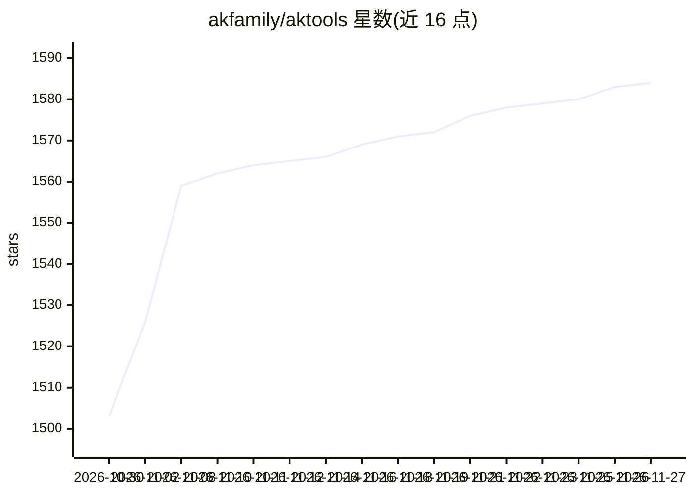

# akfamily/aktools

⭐ 1,584 · Python · MIT · 推送 2026-11-24 · [GitHub](https://github.com/akfamily/aktools) · [官网](https://aktools.akfamily.xyz/) · 个人维护 · 中文 README

**为开发者与 AI 助手提供 AKShare 财经数据的 HTTP API 与 MCP 服务**

AKTools 把开源财经数据接口库 AKShare 的近千个接口封装为两种服务：HTTP API（任何能发 HTTP 请求的语言或软件调用，支持 CSV/Excel 下载、接口搜索、60 秒结果缓存）和 MCP 服务（在 Claude、Cursor、Codex 等 AI 助手中用自然语言查询，提供 search_interfaces、describe_interface、get_data 三个工具）。要求 Python 3.11.5+（64 位），不加工数据、仅转发请求，数据仅供学术研究。

## 筛选速览

| 维度 | 判定 | 备注 |
|---|---|---|
| AI 角色 | `ai-ecosystem` | LLM/agent 周边工具 |
| 许可风险 | `permissive` | MIT |
| 部署形态 | `self-host` | docker 或自建部署 |
| 模型依赖 | — | README 未给出锁定关系 |
| 硬件要求 | — | 无带数字的原话,不猜 |
| 安装摩擦 | `low` | 无编译、无系统依赖或容器化 |
| 成熟度 | — | 结构信号不足 |

## 能力要点

- 一行命令启动 HTTP API，跨语言返回标准 JSON
- MCP 服务提供 3 个工具供 AI 助手自然语言查询
- 支持 uvx 免安装配置到多种 AI 助手
- 提供 Dockerfile 与 Gunicorn 多进程部署

## 适用场景

- 用 Java/Go/Rust 等语言通过网址获取 A 股行情等财经数据
- 在 Claude Code 或 Cursor 中用自然语言查股票行情
- 量化研究流程中批量下载数据为 CSV/Excel

## 场景标签

`金融量化` · 领域:学习与行业

## 证据(README 行号)

> L5: > AKTools exposes AKShare's financial data as an HTTP API and an MCP server, so you can fetch it from any programmin
> L19: AKTools 把开源财经数据接口库 AKShare 的近千个接口变成两种开箱即用的服务：
> L22: - **MCP 服务**：在 WorkBuddy、Codex、Cursor、Claude 等 AI 助手中直接用自然语言提问，助手会自己查找接口、填写参数并取回数据。

## 星数曲线

2026-10-30 1,503 → 2026-11-27 1,584（+81）

---
*卡片 v1 · prompt 1.4 · 生成 2026-11-23 · 置信度 high · 依据 README sha `caf8f161883e` · [字段定义](../../DATASET.md)*
