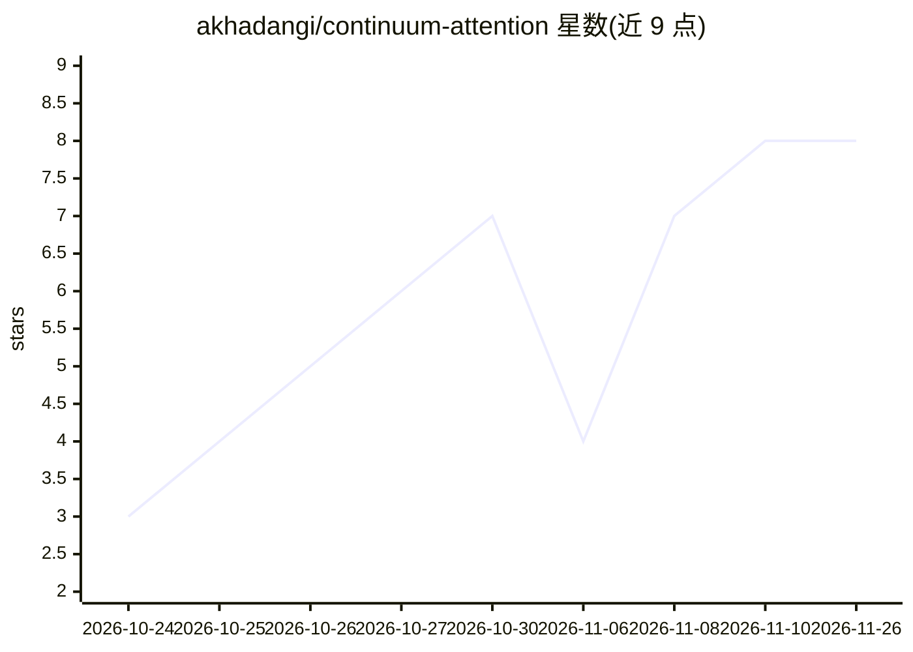

# akhadangi/continuum-attention

⭐ 8 · Python · Apache-2.0 · 推送 2026-10-21 · [GitHub](https://github.com/akhadangi/continuum-attention) · 个人维护

**Continuum Attention 注意力机制的官方论文实现库**

论文 Continuum Attention 的官方实现：在分段线性连续 key/value 轨迹上做因果注意力，用闭式指数矩与解析一阶梯度计算。提供两套实现：Apple Silicon/Metal 路径用于论文中约 5M 参数 TinyStories 实验（五种子对照），NVIDIA CUDA v6 路径提供约 101M 参数 CA-S 解码器、单 GPU 训练与单节点 Slurm 启动脚本。随附数值正确性/因果掩码测试、基准脚本与实验复现流程；不提供预训练权重或缓存数据集。

## 筛选速览

| 维度 | 判定 | 备注 |
|---|---|---|
| AI 角色 | `ai-native` | 本体是模型或模型工具 |
| 许可风险 | `permissive` | Apache-2.0 |
| 部署形态 | `library` | 以包/库形式分发 |
| 模型依赖 | — | README 未给出锁定关系 |
| 硬件要求 | — | 无带数字的原话,不猜 |
| 安装摩擦 | `medium` | 含编译或系统依赖之一 |
| 成熟度 | — | 结构信号不足 |

## 能力要点

- 两套实现：Apple Silicon Metal 路径与 NVIDIA CUDA v6 路径
- 提供论文五种子 TinyStories 实验的复现脚本与 holdout 评估流程
- 附 CPU float64 解析梯度参照与 GPU 数值/因果性校验测试
- Metal 与 CUDA 源码随仓库分发，不含预训练 checkpoint

## 适用场景

- 复现论文中的 TinyStories 训练与对照实验
- 在自己的注意力机制研究中引入或对照 CA 算子
- 在 Apple Silicon 或 NVIDIA GPU 上验证注意力内核的数值正确性

## 场景标签

`模型训练` · 领域:训练与推理

## 证据(README 行号)

> L9: **Continuum Attention (CA)** is causal attention over continuous, piecewise-linear key/value trajectories, using clo
> L11: This repository provides two implementations:
> L13: - **Apple Silicon / Metal:** the approximately 5M-parameter TinyStories experiments and five-seed comparisons repor

## 星数曲线

2026-10-24 3 → 2026-11-26 8（+5）

---
*卡片 v1 · prompt 1.4 · 生成 2026-11-20 · 置信度 high · 依据 README sha `dd3c367871c9` · [字段定义](../../DATASET.md)*
