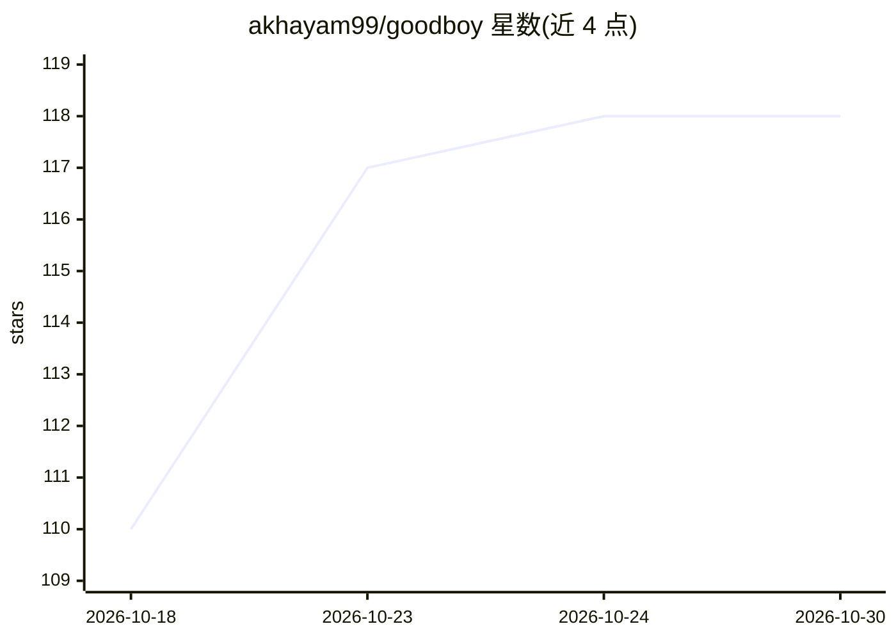

# akhayam99/goodboy

⭐ 118 · TypeScript · NOASSERTION · 推送 2026-10-29 · [GitHub](https://github.com/akhayam99/goodboy) · [官网](https://goodboy-ai.dev/) · 个人维护

**管理编码代理会话的 macOS/Linux 桌面应用**

基于 Tauri 2、React 19、TypeScript 和 SQLite 的桌面应用，面向使用编码代理的开发者：接入 Claude、Codex、Cursor 等共七个提供商，指向本地仓库后交付任务。每个任务成为独立会话，保留目标、决策与摘要，使后续接手的代理自带上下文。数据存储在本地 ~/.goodboy，无账号与自有服务端，工具密钥存入系统凭据库。macOS 经 Homebrew 或 .dmg 安装，Linux 提供 AppImage/.deb/.rpm；源码运行需 Node 22+、pnpm 与 Rust 工具链。

## 筛选速览

| 维度 | 判定 | 备注 |
|---|---|---|
| AI 角色 | `ai-ecosystem` | LLM/agent 周边工具 |
| 许可风险 | `none` | NOASSERTION |
| 部署形态 | `desktop` | 安装包/桌面程序 |
| 模型依赖 | — | README 未给出锁定关系 |
| 硬件要求 | — | 无带数字的原话,不猜 |
| 安装摩擦 | `low` | 无编译、无系统依赖或容器化 |
| 成熟度 | — | 结构信号不足 |

## 能力要点

- 接入 Claude、Codex、Cursor 等七个代理提供商
- 会话保留目标、决策与摘要，代理接手时自带上下文
- 任务、决策与用量记录留在本地 ~/.goodboy，无账号与服务端
- 提供 .dmg、AppImage、.deb、.rpm 与 Homebrew 安装途径

## 适用场景

- 在桌面端统一管理多个编码代理的任务与会话
- 让不同代理接力同一任务而不必重复交代背景
- 本地保留代理工作记录与用量数据

## 场景标签

`编码 Agent` · 领域:编码与开发

## 证据(README 行号)

> L14: Goodboy is a desktop app for coding agents, on **macOS** and **Linux**. Connect the providers you already use, Clau
> L59: - Concepts: sessions, workspaces, projects and how they fit

## 星数曲线

2026-10-18 110 → 2026-10-30 118（+8）

---
*卡片 v1 · prompt 1.4 · 生成 2026-10-23 · 置信度 mid · 依据 README sha `50d88173b155` · [字段定义](../../DATASET.md)*
