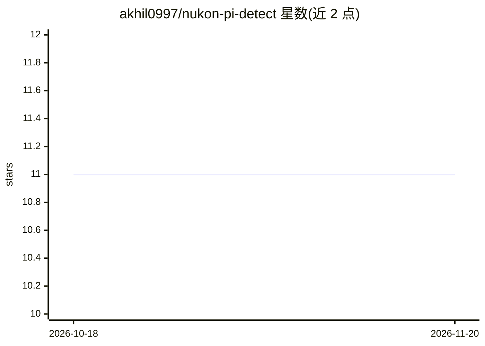

# akhil0997/nukon-pi-detect

⭐ 11 · Python · NOASSERTION · 推送 2026-05-19 · [GitHub](https://github.com/akhil0997/nukon-pi-detect) · [官网](https://nukonai.com/) · 个人维护

**为 LLM 应用提供本地无网络的提示注入检测 CLI/库**

确定性提示注入检测工具，以 CLI 和 Python 库两种形式提供：内置约 60 条规则覆盖经典注入、越狱、分隔符逃逸、Unicode 走私、间接注入五类攻击模式，采用编译正则与 Unicode 码点扫描，典型输入毫秒级返回判定。置信度分数按补集乘积聚合，按阈值输出 CLEAN/SUSPICIOUS/MALICIOUS 三级结论及非零退出码，可接入 GitHub Actions 与 pre-commit 使构建失败。运行时零依赖，要求 Python 3.10+；README 明确声明它不拦截、不审计，不是完整防御。

## 筛选速览

| 维度 | 判定 | 备注 |
|---|---|---|
| AI 角色 | `ai-native` | 本体是模型或模型工具 |
| 许可风险 | `none` | NOASSERTION |
| 部署形态 | `library` | 以包/库形式分发 |
| 模型依赖 | — | README 未给出锁定关系 |
| 硬件要求 | — | 无带数字的原话,不猜 |
| 安装摩擦 | `low` | 无编译、无系统依赖或容器化 |
| 成熟度 | — | 结构信号不足 |

## 能力要点

- 约 60 条模式覆盖五类攻击家族（经典注入/越狱/分隔符逃逸/Unicode 走私/间接注入）
- 无 LLM 调用、无网络、零运行时依赖，毫秒级返回判定
- 置信度补集乘积聚合与 CLEAN/SUSPICIOUS/MALICIOUS 阈值分级
- 提供 GitHub Actions 与 pre-commit 集成方式及 HTML 报告

## 适用场景

- 在 CI 流水线中扫描系统提示词文件并拦截可疑注入
- 对用户输入字符串做发布前的快速注入检查
- 通过 pre-commit 钩子扫描仓库中的提示词资源

## 场景标签

`网络安全` · 领域:学习与行业

## 证据(README 行号)

> L8: **A tiny, fast, deterministic prompt-injection detector.**
> L9: CLI + Python library. No LLM calls. No network. Zero runtime dependencies.
> L26: `nukon-pi-detect` is that check. It's ~60 curated patterns across five attack families, compiled regex + Unicode co

## 星数曲线

2026-10-18 11 → 2026-11-20 11（+0）

---
*卡片 v1 · prompt 1.4 · 生成 2026-11-18 · 置信度 high · 依据 README sha `e2656065e0d6` · [字段定义](../../DATASET.md)*
