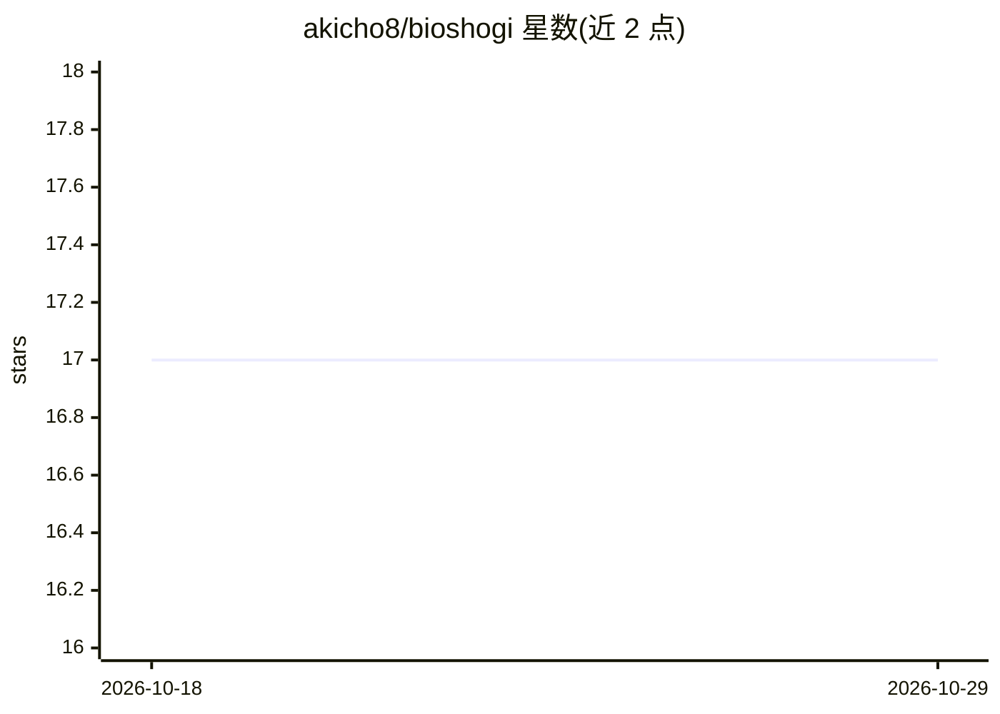

# akicho8/bioshogi

⭐ 17 · HTML · AGPL-3.0 · 推送 2026-04-06 · [GitHub](https://github.com/akicho8/bioshogi) · [官网](https://www.shogi-extend.com) · 个人维护

**将棋棋谱库：格式互转、棋谱解析与随机走子 AI**

Ruby 编写的将棋库，提供 KIF/KI2/BOD/CSA/SFEN 等棋谱格式的读取与相互转换、盘面与坐标解析、棋谱重放。支持从棋谱抽取战术信息，内置超弱 AI（守规则随机走子）与 NegaAlpha 探索（NegaMax）日志示例，可改变盘面尺寸（如 5五将棋、3x3），并演示诘み（将死）判定基准测试。面向将棋应用开发者，以 Ruby gem 与源码形式提供。

## 筛选速览

| 维度 | 判定 | 备注 |
|---|---|---|
| AI 角色 | `ai-native` | 本体是模型或模型工具 |
| 许可风险 | `viral` | AGPL-3.0 |
| 部署形态 | `None` |  |
| 模型依赖 | — | README 未给出锁定关系 |
| 硬件要求 | — | 无带数字的原话,不猜 |
| 安装摩擦 | `low` | 无编译、无系统依赖或容器化 |
| 成熟度 | — | 结构信号不足 |

## 能力要点

- KIF/KI2/BOD/CSA/SFEN 等棋谱格式读取与相互转换
- 内置守规则随机走子的超弱 AI 与 NegaAlpha 搜索
- 支持 9x9 之外的可变盘面尺寸（5五将棋、3x3）
- 盘面文本、坐标、棋子信息的解析 API

## 适用场景

- 读取并转换各种格式的将棋棋谱文件
- 在 Ruby 应用中重放棋谱并查询盘面状态
- 实现 AI 自对弈或做将死判定的实验

## 场景标签

 · 领域:游戏/棋类软件库

## 证据(README 行号)

> L1: * 将棋の棋譜相互変換、棋譜から戦術抽出、超弱いAIなどのライブラリ
> L52: *** AI同士の対局 (ルールを守った上でランダムに指してみる)
> L373:  pp Diver::NegaAlphaDiver.run(player: container.player_at(:black), depth_max: 1)

## 星数曲线

2026-10-18 17 → 2026-10-29 17（+0）

---
*卡片 v1 · prompt 1.4 · 生成 2026-10-29 · 置信度 high · 依据 README sha `86a05a4a41fe` · [字段定义](../../DATASET.md)*
