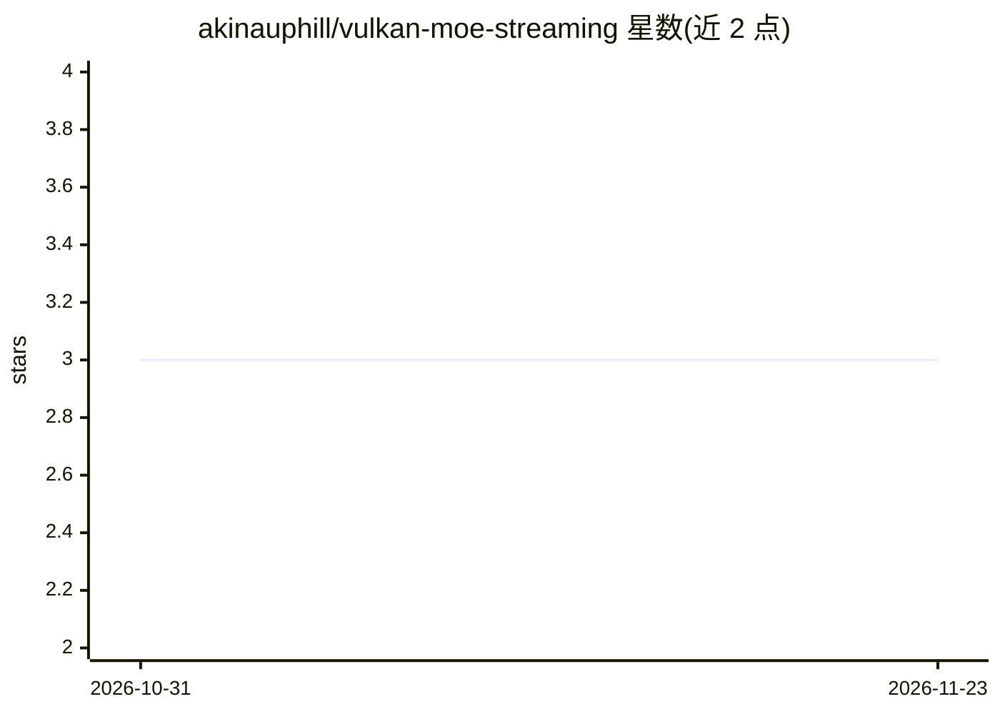

# akinauphill/vulkan-moe-streaming

⭐ 3 · Shell · MIT · 推送 2026-10-10 · [GitHub](https://github.com/akinauphill/vulkan-moe-streaming) · 个人维护

**让 AMD/Vulkan GPU 游戏本从 NVMe 流式运行超 RAM 的 MoE 模型**

一个 llama.cpp 补丁：将 MoE 专家权重从 NVMe 以 16 路并行读取（6-9 GB/s）载入 RAM 缓存（默认 12 GB），并把最热专家提升到 VRAM 层（默认 4 GB），同时做下一层预取，替代操作系统的 mmap 分页。基准（RX 7800 XT、32 GB RAM、87 GB GLM-5.3-Flash）显示答案生成 1.9 倍、长 prompt 读取 7.2 倍于原版。限制：仅单机单模型实测、单会话、短 prompt 启动延迟约 5 秒；Linux 可构建未测速。提供 Windows 免安装 exe 或 MSYS2/Linux 脚本自建。

## 筛选速览

| 维度 | 判定 | 备注 |
|---|---|---|
| AI 角色 | `ai-ecosystem` | LLM/agent 周边工具 |
| 许可风险 | `permissive` | MIT |
| 部署形态 | `desktop` | 安装包/桌面程序 |
| 模型依赖 | local-ok | 支持本地模型 |
| 硬件要求 | `gpu-8g` | |
| 安装摩擦 | `high` | 编译与系统依赖俱全 |
| 成熟度 | — | 结构信号不足 |

## 能力要点

- RAM 专家缓存 + VRAM 热专家两层结构与下一层路由预取
- 16 路非缓冲并行 NVMe 读取，6-9 GB/s
- 启动 OpenAI 兼容 API（llama-server，127.0.0.1:8080/v1）
- 提供缓存/VRAM/I/O 线程等运行时调参

## 适用场景

- 在 32 GB 内存游戏 PC 上运行文件为内存 2-4 倍的 MoE 大模型
- 让本地 LLM 在 AMD Radeon 消费卡上获得更快生成速度
- 为本地聊天前端（如 Open WebUI、SillyTavern）提供后端

## 场景标签

`推理引擎` · 领域:训练与推理

## 证据(README 行号)

> L3: # Vulkan MoE Streaming for llama.cpp
> L48: It's a patch for llama.cpp that takes expert loading away from the operating system:
> L5: **Run Mixture-of-Experts models that are several times bigger than your RAM on an ordinary gaming PC, about twice as

## 星数曲线

2026-10-31 3 → 2026-11-23 3（+0）

---
*卡片 v1 · prompt 1.4 · 生成 2026-11-22 · 置信度 high · 依据 README sha `8388e66056a3` · [字段定义](../../DATASET.md)*
