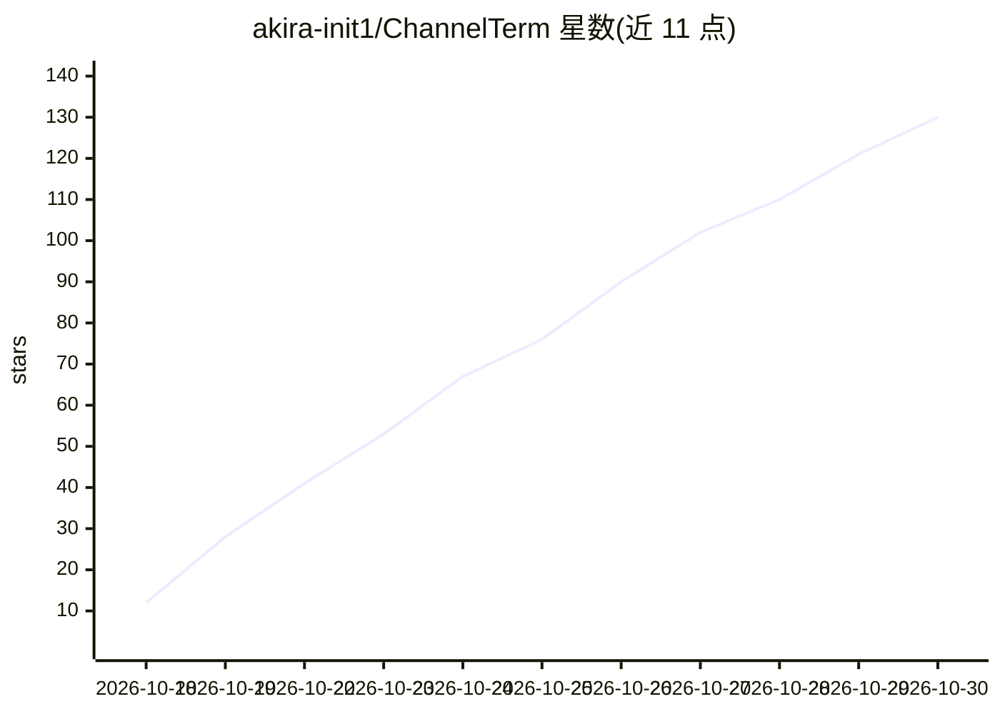

# akira-init1/ChannelTerm

⭐ 130 · Go · Apache-2.0 · 推送 2026-10-25 · [GitHub](https://github.com/akira-init1/ChannelTerm) · 个人维护

**人与 AI 共享串口/SSH 终端会话的硬件调试工具**

基于 Go 的命令行工具，通过本地 HTTP MCP Session Host 让人类终端与 AI 客户端共享同一个串口或 SSH 连接：各客户端独立读取设备输出，人类可看到 AI 下发的终端命令并轮流操作板卡。提供托管 GDB、串口桥、网络 GDB 三种 Linux 程序调试路径，支持 U-Boot 中断、诊断 ZIP 导出、共享会话内带 SHA-256 校验的文件传输（另有 SFTP/SCP）。支持 Windows/Linux/macOS，通过预编译二进制安装；HTTP 服务默认仅回环监听并使用 Bearer 令牌。

## 筛选速览

| 维度 | 判定 | 备注 |
|---|---|---|
| AI 角色 | `ai-ecosystem` | LLM/agent 周边工具 |
| 许可风险 | `permissive` | Apache-2.0 |
| 部署形态 | `desktop` | 安装包/桌面程序 |
| 模型依赖 | — | README 未给出锁定关系 |
| 硬件要求 | — | 无带数字的原话,不猜 |
| 安装摩擦 | `low` | 无编译、无系统依赖或容器化 |
| 成熟度 | — | 结构信号不足 |

## 能力要点

- 人类 CLI 与 AI/MCP 客户端共享一个串口或 SSH Session，各自独立读取输出
- 托管 GDB / 串口桥 / 网络 GDB 三种远程调试路径
- 共享会话内文件传输（SHA-256 校验、分块可取消），另有 SFTP/SCP
- 附带 Agent Skill（cterm-serial-debug）与 MCP 客户端一键配置

## 适用场景

- 调试开发板时让 AI 与我在同一终端里轮流操作
- 让 AI 通过 GDB 设置断点、单步调试板卡上的 Linux 程序
- 在共享串口会话中与 AI 之间传输固件与日志文件

## 场景标签

`编码 Agent` · 领域:编码与开发

## 证据(README 行号)

> L7: ChannelTerm lets you and your AI client share a live serial or SSH terminal. Read the same device output, follow AI 
> L29: - **Share the console:** human CLI and AI/MCP clients use one serial or SSH Session.
> L31: - **Debug Linux programs:** use managed GDB, a serial bridge, or GDB over the network.

## 星数曲线

2026-10-18 12 → 2026-10-30 130（+118）

---
*卡片 v1 · prompt 1.4 · 生成 2026-10-24 · 置信度 high · 依据 README sha `896c417f67d9` · [字段定义](../../DATASET.md)*
