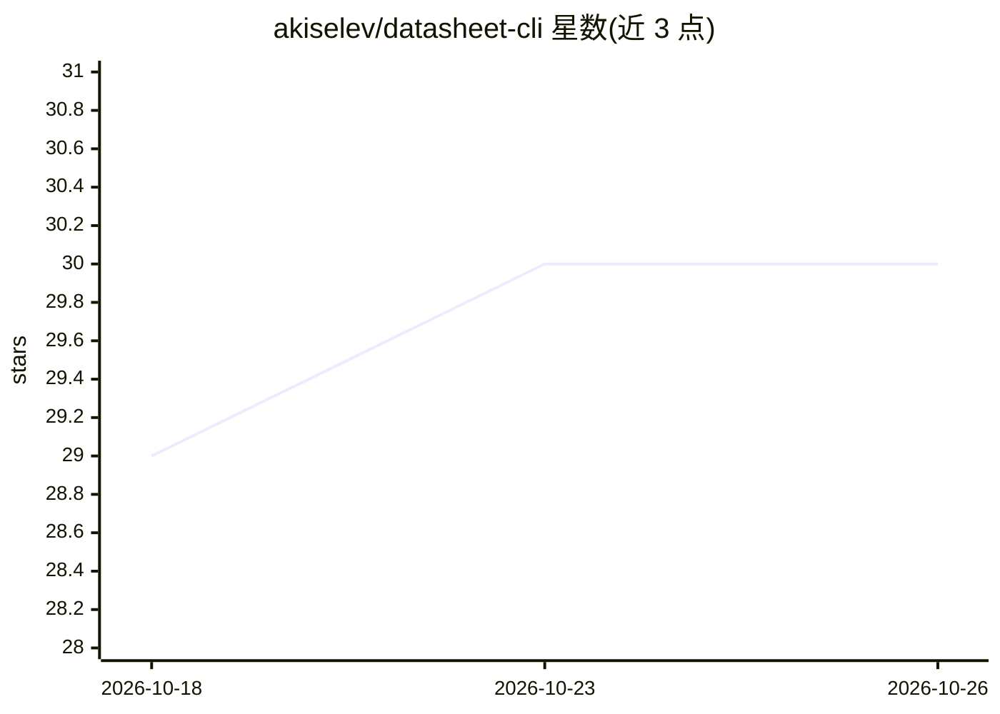

# akiselev/datasheet-cli

⭐ 30 · Rust · GPL-3.0 · 推送 2026-09-17 · [GitHub](https://github.com/akiselev/datasheet-cli) · 个人维护

**用 Gemini 从电子元件 PDF 数据手册提取结构化数据的 CLI**

Rust 编写的命令行工具：将 PDF 数据手册上传至 Gemini（默认 gemini-3.8-flash，可用 --model 覆盖），输出可导入 CAD/符号生成器/设计规则检查的结构化 JSON。提供 12 类提取任务（pinout、footprint、电气规格、电源、高速约束、应用电路网表、自定义 prompt 等），并集成 Mouser/DigiKey/JLCPCB/SnapEDA 元件搜索与下载、SVD 寄存器文件检索、库存价格查询。PDF 缓存 48 小时避免重复上传。限制：仅支持 Gemini，不支持 OpenAI/Anthropic；无 OCR 扫描件支持。

## 筛选速览

| 维度 | 判定 | 备注 |
|---|---|---|
| AI 角色 | `ai-native` | 本体是模型或模型工具 |
| 许可风险 | `viral` | GPL-3.0 |
| 部署形态 | `library` | 以包/库形式分发 |
| 模型依赖 | — | README 未给出锁定关系 |
| 硬件要求 | — | 无带数字的原话,不猜 |
| 安装摩擦 | `low` | 无编译、无系统依赖或容器化 |
| 成熟度 | — | 结构信号不足 |

## 能力要点

- 12 类提取任务输出结构化 JSON，支持自定义 prompt 与 JSON schema
- Mouser/DigiKey/JLCPCB/SnapEDA 分销商集成：搜索、下载、库存价格
- SVD 寄存器映射文件检索（872 文件、25 厂商，无需 API key）
- PDF 上传 Gemini File API 后本地缓存 48 小时

## 适用场景

- 从数据手册提取引脚表生成 KiCad 原理图符号
- 提取封装尺寸用于 PCB 焊盘设计
- 批量比较多款电源芯片的电气规格
- 查询元件库存、价格与生命周期状态

## 场景标签

`文档解析` · 领域:知识与检索

## 证据(README 行号)

> L3: A command-line tool that extracts structured data from PDF datasheets using LLMs. Point it at a datasheet, get back 
> L16: Datasheets are the lifeblood of hardware design, but they're trapped in PDFs that were designed for humans to read,
> L68: That's it. The tool handles uploading the PDF to Gemini, manages caching (PDFs are cached for 48 hours to avoid re-

## 星数曲线

2026-10-18 29 → 2026-10-26 30（+1）

---
*卡片 v1 · prompt 1.4 · 生成 2026-10-26 · 置信度 high · 依据 README sha `97a81e3f4fe2` · [字段定义](../../DATASET.md)*
