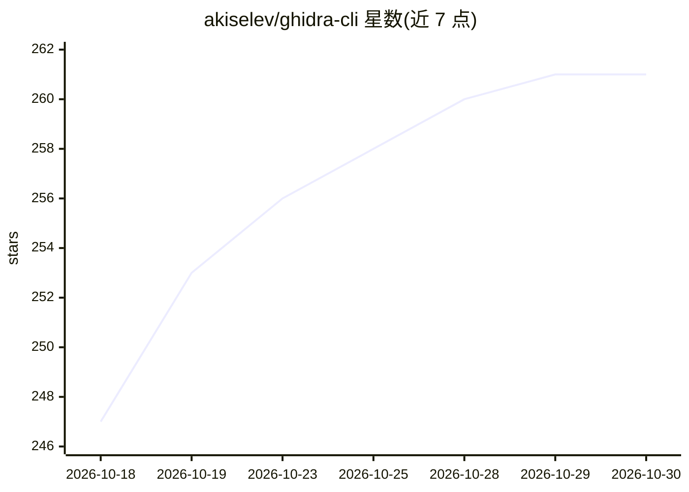

# akiselev/ghidra-cli

⭐ 261 · Rust · GPL-3.0 · 推送 2026-10-18 · [GitHub](https://github.com/akiselev/ghidra-cli) · 个人维护

**供人手或 AI 代理调用的 Ghidra 逆向工程命令行工具**

用 Rust 编写的 CLI，通过 TCP 连接运行在 Ghidra JVM 内的 Java bridge，实现函数/符号/类型/字符串/交叉引用分析、反编译、二进制补丁、调用图导出（DOT）、脚本执行与批处理，输出人类可读或 JSON 格式供 Claude Code 等 AI 编码代理消费。Ghidra 常驻内存，读命令并发、写命令独占；每项目独立 bridge 进程可并行分析。运行仅需 Ghidra 和完整 JDK，无需 Python/PyGhidra；源码安装需 Rust 1.70+。bridge 模式不支持内联 Python/Java 脚本，需保存为 .java 文件执行。

## 筛选速览

| 维度 | 判定 | 备注 |
|---|---|---|
| AI 角色 | `ai-enhanced` | 去掉 AI 部分产品仍成立 |
| 许可风险 | `viral` | GPL-3.0 |
| 部署形态 | `desktop` | 安装包/桌面程序 |
| 模型依赖 | — | README 未给出锁定关系 |
| 硬件要求 | — | 无带数字的原话,不猜 |
| 安装摩擦 | `medium` | 含编译或系统依赖之一 |
| 成熟度 | — | 结构信号不足 |

## 能力要点

- CLI 直连 Ghidra JVM 内 Java bridge，状态常驻、亚秒级查询
- 反编译/类型编辑/二进制补丁/调用图/加密常量搜索等功能集
- 读/重读/独占三车道并发控制，每项目独立 bridge 支持并行分析
- JSON 输出面向 AI 代理与机器解析，带表达式过滤 DSL

## 适用场景

- 用命令行自动化 Ghidra 的逆向与恶意软件分析流程
- 让 Claude Code 等 AI 代理驱动二进制分析与补丁
- 批量执行分析命令并导出结构化 JSON 结果

## 场景标签

`网络安全` · 领域:学习与行业

## 证据(README 行号)

> L3: A Rust CLI for automating Ghidra reverse engineering tasks. Usable directly by hand or driven by an AI coding agent 
> L34: Each project gets its own bridge process and port file, so you can analyze several binaries at once. The only runti

## 星数曲线

2026-10-18 247 → 2026-10-30 261（+14）

---
*卡片 v1 · prompt 1.4 · 生成 2026-10-22 · 置信度 high · 依据 README sha `44e346829765` · [字段定义](../../DATASET.md)*
