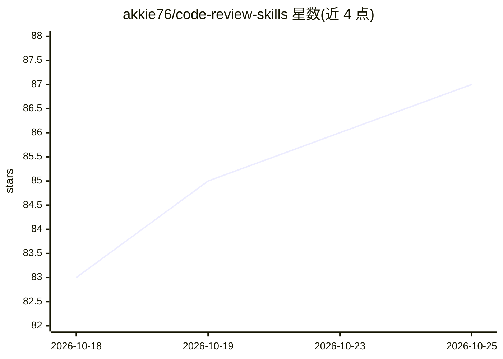

# akkie76/code-review-skills

⭐ 89 · Python · MIT · 推送 2026-10-11 · [GitHub](https://github.com/akkie76/code-review-skills) · [官网](https://gihyo.jp/book/2026/978-4-297-15768-5) · 个人维护

**面向 Codex 与 Claude Code 的证据驱动代码审查 Skill**

一个安装在 Codex 与 Claude Code 中的代码审查技能包：通过 git clone 发布标签并复制到宿主 agent 的 skills 目录使用。审查流程要求先确定审查范围与仓库规则，沿受影响代码路径追踪变更行为，按风险检查正确性、接口、设计、安全、可靠性、测试与文档。审查意见以 MUST/SHOULD/BETTER/NITS 动作级别加视点标注，须给出位置与具体证据。基于日本书籍《コードレビューの教科書》的理念独立改编。项目特定上下文需写入仓库的 AGENTS.md/CLAUDE.md。

## 筛选速览

| 维度 | 判定 | 备注 |
|---|---|---|
| AI 角色 | `ai-ecosystem` | LLM/agent 周边工具 |
| 许可风险 | `permissive` | MIT |
| 部署形态 | `None` |  |
| 模型依赖 | — | README 未给出锁定关系 |
| 硬件要求 | — | 无带数字的原话,不猜 |
| 安装摩擦 | `low` | 无编译、无系统依赖或容器化 |
| 成熟度 | — | 结构信号不足 |

## 能力要点

- MUST/SHOULD/BETTER/NITS 四级动作标注加视点的审查意见格式
- 要求每条 finding 给出位置与具体证据
- 沿受影响代码路径追踪变更，而非仅看改动行
- v1.0.0 起审查输出格式稳定，随版本化策略演进

## 适用场景

- 让 Codex 或 Claude Code 按统一规范审查分支变更
- 在合并前获得分级（MUST/SHOULD）的结构化审查意见
- 结合仓库 AGENTS.md/CLAUDE.md 中的项目规则做定制审查

## 场景标签

`代码审查` · 领域:编码与开发

## 证据(README 行号)

> L5: An evidence-driven code-review workflow for Codex and Claude Code.
> L37: ### Claude Code

## 星数曲线

2026-10-18 83 → 2026-10-25 87（+4）

---
*卡片 v1 · prompt 1.4 · 生成 2026-10-24 · 置信度 high · 依据 README sha `cf758d71ceb7` · [字段定义](../../DATASET.md)*
