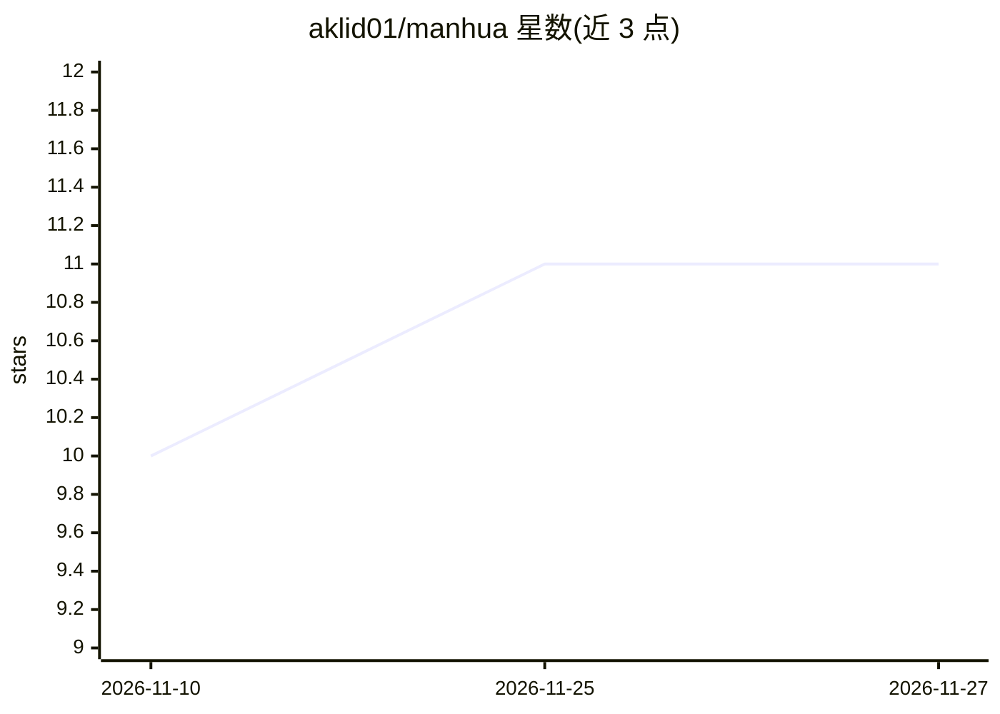

# aklid01/manhua

⭐ 11 · Python · AGPL-3.0 · 推送 2026-11-12 · [GitHub](https://github.com/aklid01/manhua) · 个人维护 · 中文 README

**把中文漫画页本地翻译为英文页的流水线工具**

本地优先的 Python 应用：输入 CBZ/ZIP/图片文件夹，依次执行气泡检测（RT-DETR）、OCR（PaddleOCR/Transformers）、中文到英文的直译与可选意译、抹除原文并排版渲染、QA 检查、可选打包为 ZIP/CBZ。中间结果以 JSON 写入章节工作区，可单阶段重跑或断点续跑。翻译后端可在 manual/MCP/Ollama/OpenAI 兼容 API 间独立配置；提供 CLI、可选 PyQt6 GUI 与修图编辑器。面向需要审校流程的读者译者与需要可检查流水线的开发者。

## 筛选速览

| 维度 | 判定 | 备注 |
|---|---|---|
| AI 角色 | `ai-native` | 本体是模型或模型工具 |
| 许可风险 | `viral` | AGPL-3.0 |
| 部署形态 | `library` | 以包/库形式分发 |
| 模型依赖 | local-ok | 支持本地模型 |
| 硬件要求 | — | 无带数字的原话,不猜 |
| 安装摩擦 | `low` | 无编译、无系统依赖或容器化 |
| 成熟度 | — | 结构信号不足 |

## 能力要点

- 检测/OCR/翻译/渲染/QA 八阶段流水线，各阶段可独立重跑与续跑
- 翻译与意译后端独立可配：manual、MCP、Ollama、OpenAI 兼容 API 带故障转移链
- Qt GUI 与修图编辑器支持区域选择、重跑 OCR/翻译、抹字与排版
- 检测默认启用 GPU，无兼容 GPU 运行时自动回退 CPU

## 适用场景

- 把整章中文漫画 CBZ 批量翻译成英文 CBZ
- 用修图编辑器人工修正 OCR 与译文后重新渲染
- 无本地模型时用 manual 模式配合外部 LLM 完成 translation
- 开发者替换检测/OCR/翻译组件构建自己的流水线

## 场景标签

`图像视频处理` `OCR` · 领域:感知与多模态

## 证据(README 行号)

> L3: Manhua Translation Pipeline is a local-first Python application for converting
> L24: 2. **Detection** - finds speech bubbles and narration regions.
> L26: 4. **Translation** - produces a literal Chinese-to-English translation.

## 星数曲线

2026-11-10 10 → 2026-11-27 11（+1）

---
*卡片 v1 · prompt 1.4 · 生成 2026-11-20 · 置信度 mid · 依据 README sha `18da57b3a0ed` · [字段定义](../../DATASET.md)*
