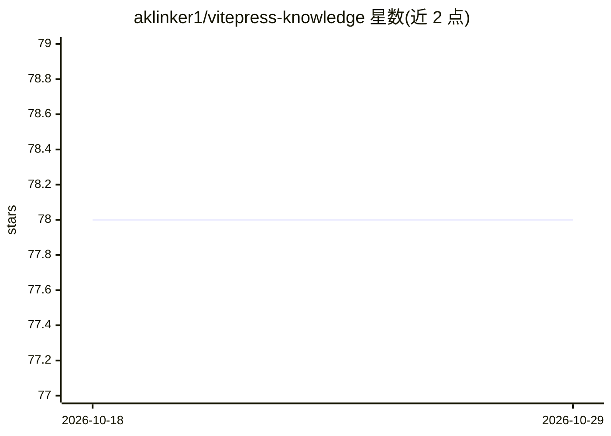

# aklinker1/vitepress-knowledge

⭐ 78 · TypeScript · MIT · 推送 2026-06-30 · [GitHub](https://github.com/aklinker1/vitepress-knowledge) · 个人维护

**为 VitePress 文档站生成知识文件并自托管 AI 聊天机器人**

由两部分组成：一个 VitePress 插件，在构建时把 markdown 文档合并为一个或多个文本知识文件，供 LLM 作为软件知识来源；以及一个轻量自托管后端，提供文档站上的 "Ask AI" 按钮与聊天窗口，并代理请求到 Google/Anthropic，避免在前端暴露 API key。以 NPM 包安装插件，后端通过 Docker Compose 部署。面向拥有 VitePress 文档站、想添加 AI 问答功能的开发者。

## 筛选速览

| 维度 | 判定 | 备注 |
|---|---|---|
| AI 角色 | `ai-native` | 本体是模型或模型工具 |
| 许可风险 | `permissive` | MIT |
| 部署形态 | `self-host` | docker 或自建部署 |
| 模型依赖 | — | README 未给出锁定关系 |
| 硬件要求 | — | 无带数字的原话,不猜 |
| 安装摩擦 | `low` | 无编译、无系统依赖或容器化 |
| 成熟度 | — | 结构信号不足 |

## 能力要点

- VitePress 插件在构建时生成合并的知识文本文件
- 自托管后端提供 "Ask AI" 按钮与聊天窗口
- 代理请求到 Google/Anthropic，避免在前端暴露 API key

## 适用场景

- 给自己的 VitePress 文档站加一个 AI 问答助手
- 把现有 markdown 文档转成 LLM 可用的知识文件
- 自托管方式控制聊天后端与 API key

## 场景标签

`聊天机器人` `文档问答` · 领域:对话与助手

## 证据(README 行号)

> L3: Free, self-hosted LLM chatbot trained on your VitePress website.
> L11: 1. Generate knowledge files based on your docs
> L12: 2. Self-host a light-weight server that sends chat messages to Google/Anthropic.

## 星数曲线

2026-10-18 78 → 2026-10-29 78（+0）

---
*卡片 v1 · prompt 1.4 · 生成 2026-10-24 · 置信度 high · 依据 README sha `bb9d12b82793` · [字段定义](../../DATASET.md)*
