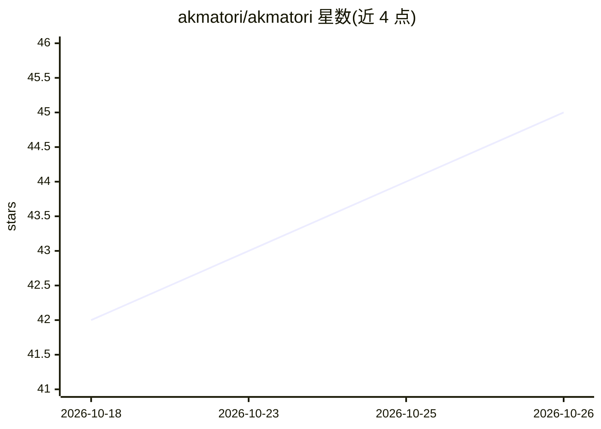

# akmatori/akmatori

⭐ 45 · Go · Apache-2.0 · 推送 2026-10-21 · [GitHub](https://github.com/akmatori/akmatori) · [官网](https://akmatori.com) · 组织维护

**自托管 AI AIOps 平台：SRE 用 LLM agent 调查与处置告警**

面向 SRE 团队的自托管 AIOps 平台（Go 后端多容器架构）：从 Alertmanager、PagerDuty、Grafana、Datadog、Zabbix webhook 及 Slack 频道接收告警，为每个事件运行完整 LLM agent 会话，通过 MCP 网关工具（SSH、Kubernetes、Zabbix、Grafana 等）查询基础设施，并结合 runbook 与跨事件记忆子代理；高危操作以提案形式等待 UI 或 Slack 审批后执行。支持多家 LLM 提供商与任意 OpenAI 兼容端点，通过 Docker Compose 拉取 GHCR 预构建镜像部署，模型字段为自由文本，无需升级即可使用新模型 ID。

## 筛选速览

| 维度 | 判定 | 备注 |
|---|---|---|
| AI 角色 | `ai-ecosystem` | LLM/agent 周边工具 |
| 许可风险 | `permissive` | Apache-2.0 |
| 部署形态 | `self-host` | docker 或自建部署 |
| 模型依赖 | locked-api |  |
| 硬件要求 | — | 无带数字的原话,不猜 |
| 安装摩擦 | `low` | 无编译、无系统依赖或容器化 |
| 成熟度 | — | 结构信号不足 |

## 能力要点

- 多源告警接入：Alertmanager/PagerDuty/Grafana/Datadog/Zabbix webhook 与 Slack 频道监听
- LLM agent 通过 SSH、Kubernetes、Zabbix、Grafana 等网关工具调查事件
- 审批门控修复：高危操作需在 UI 或 Slack 批准后才执行
- runbook 检索与跨事件记忆子代理，调查结束时写入持久记忆

## 适用场景

- SRE 团队接收监控告警后自动开展事件调查
- 在自有基础设施上审批并执行修复操作
- 定时运行 agent 排查任务并把结果发到 Slack 频道

## 场景标签

`工作流自动化` · 领域:效率与自动化

## 证据(README 行号)

> L5: Ingests alerts from your monitoring stack, investigates them with LLM agents that reach your
> L21: 2. **An agent investigates** — a full LLM agent session queries your infrastructure through gateway tools (SSH, Kub

## 星数曲线

2026-10-18 42 → 2026-10-26 45（+3）

---
*卡片 v1 · prompt 1.4 · 生成 2026-10-25 · 置信度 high · 依据 README sha `f007b9220c15` · [字段定义](../../DATASET.md)*
