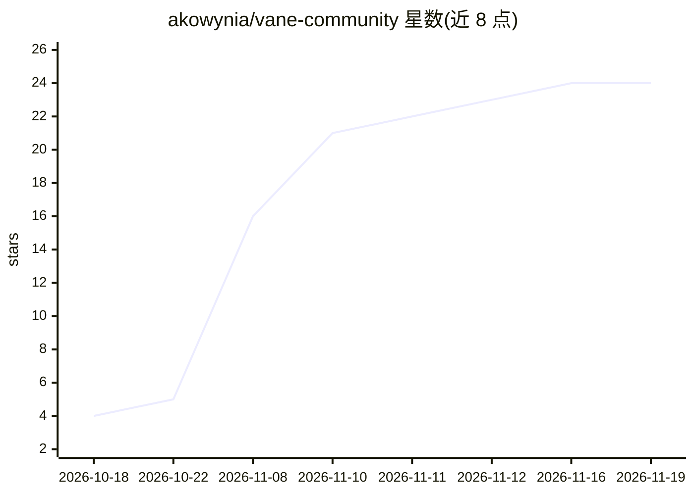

# akowynia/vane-community

⭐ 24 · TypeScript · NOASSERTION · 推送 2026-11-18 · [GitHub](https://github.com/akowynia/vane-community) · [官网](https://lowcyai.pl/vane-community-architektura-i-wdrozenie-prywatnego-silnika-odpowiedzi-ai/) · 个人维护

**自托管隐私优先的 AI 搜索问答引擎，支持本地与云端模型**

基于 Vane v1.12.2 独立延续开发的开源 AI 回答引擎：通过 SearXNG 元搜索聚合网络知识，结合本地 LLM（Ollama、LM Studio）或 OpenAI/Anthropic/Gemini/Groq 等云端提供商，生成带引用来源的回答。提供多用户与访问控制、个性化 Waypoint 空间与定时任务、Scratchpad 画布、AI 演示文稿生成（Beta）、REST API 与 MCP Server 模式。主推 Docker 部署（含内置 SearXNG 镜像），也可用 yarn 从源码构建；非 Docker 方式需自行安装 SearXNG。

## 筛选速览

| 维度 | 判定 | 备注 |
|---|---|---|
| AI 角色 | `ai-native` | 本体是模型或模型工具 |
| 许可风险 | `permissive` | NOASSERTION |
| 部署形态 | `self-host` | docker 或自建部署 |
| 模型依赖 | local-ok | 支持本地模型 |
| 硬件要求 | — | 无带数字的原话,不猜 |
| 安装摩擦 | `low` | 无编译、无系统依赖或容器化 |
| 成熟度 | `idea` | |

## 能力要点

- SearXNG 元搜索驱动的带引用来源回答，支持本地与云端模型混用
- 多用户账户、角色权限与按用户/访客的 token 限额
- 可独立作为 MCP Server 供 Claude Desktop/Cursor 等外部助手调用
- Speed/Balanced/Quality 三种搜索模式与图像视频搜索

## 适用场景

- 在自有硬件上搭建隐私可控的 AI 搜索问答服务
- 为团队提供带配额与权限管理的共享 AI 搜索
- 通过 REST API 或 MCP 接入到其他工具与 AI 助手

## 场景标签

`AI 助手` `聊天机器人` · 领域:对话与助手

## 证据(README 行号)

> L8: Vane-Community is a **privacy-focused AI answering engine** that runs entirely on your own hardware. It combines kno
> L18: 🤖 **Support for all major AI providers** - Use local LLMs through Ollama or connect to OpenAI, Anthropic Claude, Go

## 星数曲线

2026-10-18 4 → 2026-11-19 24（+20）

---
*卡片 v1 · prompt 1.4 · 生成 2026-11-18 · 置信度 high · 依据 README sha `47f739b84fe7` · [字段定义](../../DATASET.md)*
