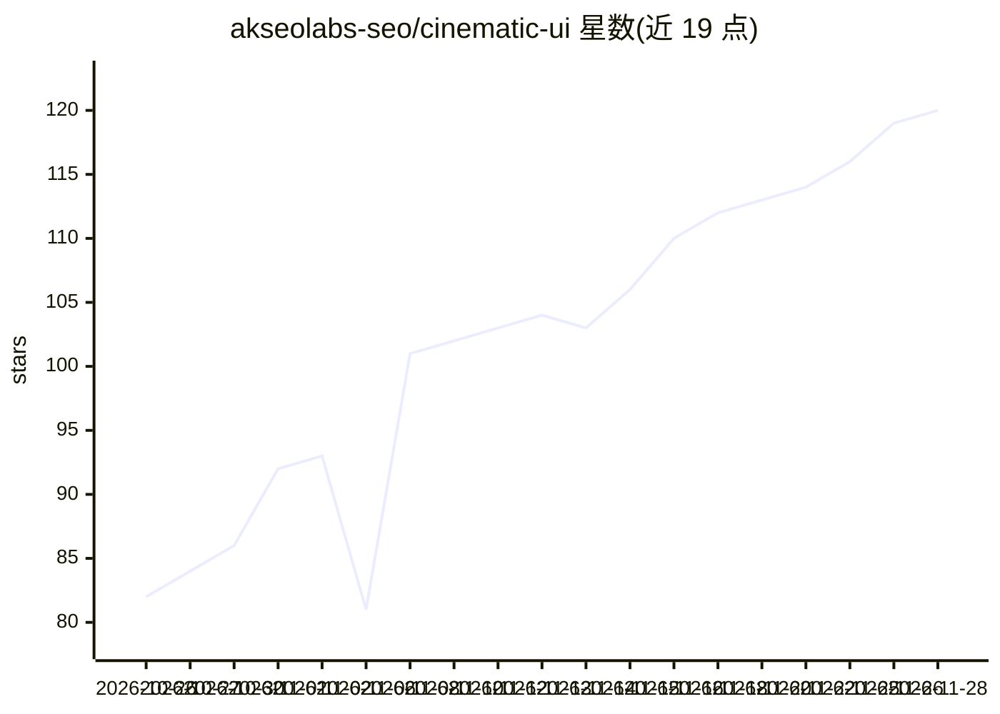

# akseolabs-seo/cinematic-ui

⭐ 120 · JavaScript · MIT · 推送 2026-11-16 · [GitHub](https://github.com/akseolabs-seo/cinematic-ui) · [官网](https://cinematicskill.com/) · 组织维护 · 中文 README

**让 AI 编码 agent 以电影执导方式设计网站与后台的技能**

以 SKILL.md 形式分发的 agent 技能：agent 先选定导演并提取 5–7 个可观察机制、确定媒介、撰写分镜表，再生成页面并对三个视口的接触印样进行 screening 校验。2.0 增加 App 模式（后台/仪表盘规则与八状态筛查）、任意影片的实时考据、14 种调色方案、多种媒介代码包与 44 种文字表演。包含 Openverse/Wikimedia 等开放素材库检索脚本。构建于 GSAP、Three.js 与 Lenis 之上，安装后无需构建；筛查渲染需项目内安装 playwright-core，渲染视频另需 ffmpeg。README 自述未在 Safari、Firefox、真机与读屏器上验证。

## 筛选速览

| 维度 | 判定 | 备注 |
|---|---|---|
| AI 角色 | `ai-ecosystem` | LLM/agent 周边工具 |
| 许可风险 | `permissive` | MIT |
| 部署形态 | `library` | 以包/库形式分发 |
| 模型依赖 | — | README 未给出锁定关系 |
| 硬件要求 | — | 无带数字的原话,不猜 |
| 安装摩擦 | `medium` | 含编译或系统依赖之一 |
| 成熟度 | — | 结构信号不足 |

## 能力要点

- 10 阶段制作流程：从 logline 到 screening 与交付报告
- App 模式针对仪表盘/后台，八状态跨视口筛查脚本
- 44 种文字表演与多种媒介视觉代码包（kit/looks.js）
- 开放素材库检索脚本返回剪辑片段并生成 CREDITS.md

## 适用场景

- 让 Claude Code/Codex 等 agent 按指定导演风格生成产品官网
- 给后台/管理面板生成有辨识度的界面设计
- 为页面查找可合法使用的开放授权影像素材

## 场景标签

`代码生成` `提示工程` · 领域:Agent 开发

## 证据(README 行号)

> L3: **An agent skill that directs websites and apps the way films are made.**
> L118: **Any agent, one line** (Claude Code, Codex, Cursor, Gemini CLI and more, via skills.sh)
> L136: **Any other agent:** point it at `SKILL.md`. Everything is plain Markdown, plain JavaScript and Node scripts, so

## 星数曲线

2026-10-26 82 → 2026-11-28 120（+38）

---
*卡片 v1 · prompt 1.4 · 生成 2026-11-28 · 置信度 mid · 依据 README sha `e668e16db00e` · [字段定义](../../DATASET.md)*
