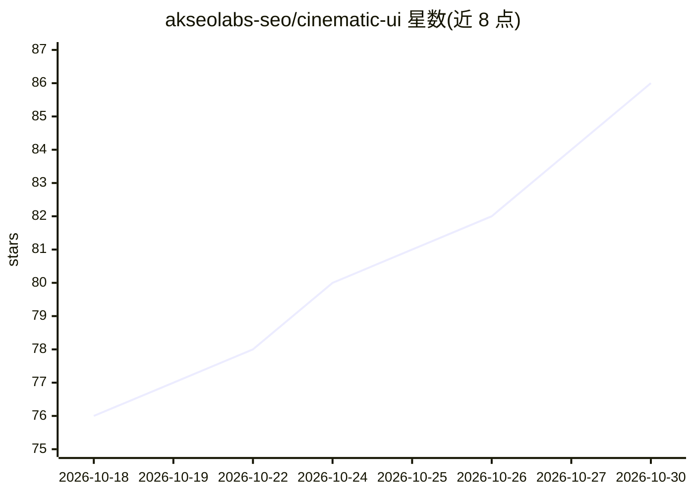

# akseolabs-seo/cinematic-ui

⭐ 86 · MIT · 推送 2026-04-08 · [GitHub](https://github.com/akseolabs-seo/cinematic-ui) · [官网](https://akseolabs.com/) · 组织维护 · 中文 README

**让 AI 编程代理以导演工作流设计网站的跨工具技能包**

面向 Claude Code、Codex、Cursor、Windsurf、Copilot、Gemini 等 AI 编程代理的技能包：引导代理按四阶段流程建站——选择导演与影片、研究其视觉语言、转译为 decisions.md/storyboard.md/compiled-spec.md 等中间产物，再据此实现 HTML/CSS/JS。内置按阶段组织的参考规则文件与数据库（200+ 导演条目、1,486 站点设计 DNA 索引、构图/排版/色彩转译库等），并含 anti-garbage、anti-convergence 检查机制。通过 git clone 到各工具的技能/rules 目录安装，MIT 许可。

## 筛选速览

| 维度 | 判定 | 备注 |
|---|---|---|
| AI 角色 | `ai-ecosystem` | LLM/agent 周边工具 |
| 许可风险 | `permissive` | MIT |
| 部署形态 | `None` |  |
| 模型依赖 | — | README 未给出锁定关系 |
| 硬件要求 | — | 无带数字的原话,不猜 |
| 安装摩擦 | `low` | 无编译、无系统依赖或容器化 |
| 成熟度 | — | 结构信号不足 |

## 能力要点

- 四阶段导演工作流：选片研究→场景叙事→规格编译→实现
- 支持 Claude Code / Codex / Cursor / Windsurf / Copilot / Gemini 六类工具
- 内置 200+ 导演数据与 1,486 站点设计 DNA 索引等参考库
- 含 anti-garbage 与 anti-convergence（哈希去重）检查机制

## 适用场景

- 让 AI 编程代理按某部电影的视觉语言生成网站
- 为不同编码代理统一注入结构化设计流程
- 需要中间产物（分镜/规格文档）的可审查建站流程

## 场景标签

`代码生成` · 领域:编码与开发

## 证据(README 行号)

> L5:  A cross-agent skill for designing websites using a director-and-film research workflow.
> L22: `cinematic-ui` is a skill package for AI coding agents (Claude Code, Codex, Cursor, Windsurf, Gemini, Copilot). It 
> L44: |Tool|Entry File|Install Path|

## 星数曲线

2026-10-18 76 → 2026-10-30 86（+10）

---
*卡片 v1 · prompt 1.4 · 生成 2026-10-24 · 置信度 high · 依据 README sha `80051b3a2d01` · [字段定义](../../DATASET.md)*
