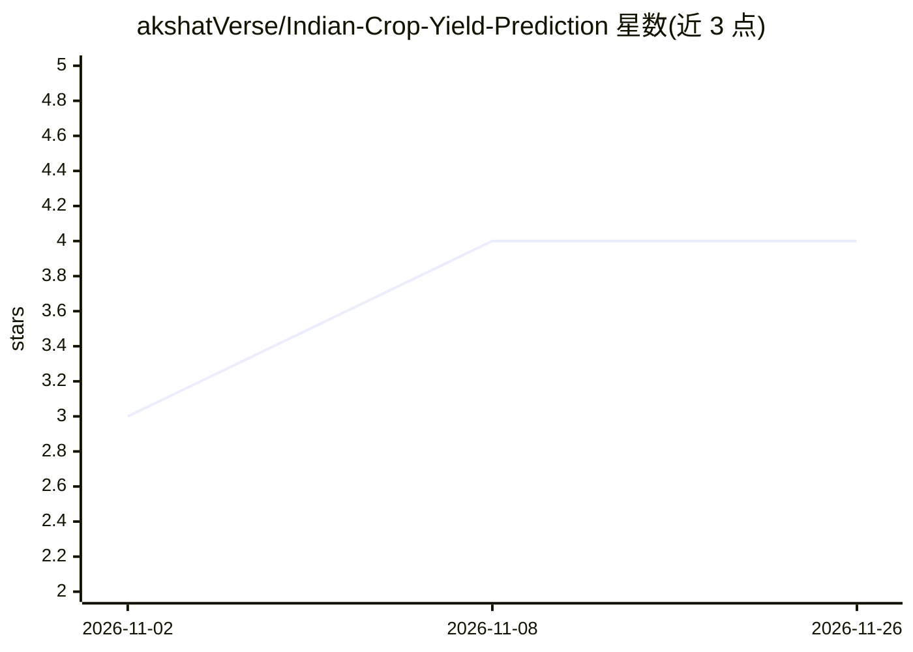

# akshatVerse/Indian-Crop-Yield-Prediction

⭐ 4 · Python · MIT · 推送 2026-10-31 · [GitHub](https://github.com/akshatVerse/Indian-Crop-Yield-Prediction) · 个人维护

**面向印度农业数据的产量预测机器学习端到端项目**

一个端到端机器学习与探索性数据分析项目：融合 1997–2020 年印度各邦作物生产记录、气象观测与土壤 NPK/pH 数据，构建 19,689 条记录、16 个特征的统一数据集，训练 5 种回归算法预测单位面积产量。流程包含目标泄漏防护（剔除 production 列）、14 张 EDA 可视化、R²/MAE/RMSE 三个指标的性能基准，其中 KNN 在留出测试集上取得最高 R²。需 Python 3.8+ 与 Git，通过 requirements.txt 安装依赖后运行主脚本。

## 筛选速览

| 维度 | 判定 | 备注 |
|---|---|---|
| AI 角色 | `ai-native` | 本体是模型或模型工具 |
| 许可风险 | `permissive` | MIT |
| 部署形态 | `library` | 以包/库形式分发 |
| 模型依赖 | — | README 未给出锁定关系 |
| 硬件要求 | — | 无带数字的原话,不猜 |
| 安装摩擦 | `low` | 无编译、无系统依赖或容器化 |
| 成熟度 | — | 结构信号不足 |

## 能力要点

- 融合作物产量、气象、土壤三类数据源的单一流水线
- 训练并基准 5 种回归算法（Linear/Decision Tree/Random Forest/SVR/KNN）
- 剔除 production 列的目标泄漏防护机制
- 基于 matplotlib/seaborn 的 14 张探索性可视化

## 适用场景

- 按邦、作物、季节预测印度农业单位面积产量
- 学习多源农业数据融合与回归建模的完整流程
- 复现并对比不同回归算法在产量数据上的表现

## 场景标签

 · 领域:农业/机器学习科研

## 证据(README 行号)

> L9: An end-to-end Machine Learning and Exploratory Data Analysis (EDA) project that predicts agricultural crop yields ac
> L15: This project integrates three complementary data sources into a unified analytical dataset (19,689 records across 1

## 星数曲线

2026-11-02 3 → 2026-11-26 4（+1）

---
*卡片 v1 · prompt 1.4 · 生成 2026-11-21 · 置信度 high · 依据 README sha `38409caa4ed3` · [字段定义](../../DATASET.md)*
