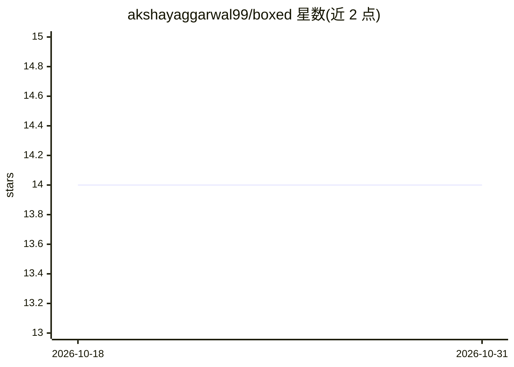

# akshayaggarwal99/boxed

⭐ 14 · TeX · MIT · 推送 2026-09-11 · [GitHub](https://github.com/akshayaggarwal99/boxed) · 个人维护

**面向 AI Agent 的自托管安全代码执行沙箱引擎**

为写代码的 AI Agent 提供临时 Docker 沙箱执行环境：Go 控制面提供 REST/WebSocket API 与 API-key 鉴权，Rust agent 注入沙箱内经 JSON-RPC 流式回传 stdout/stderr 与产物文件。Docker 驱动为目前唯一实现，采用只读根文件系统、CapDrop ALL、network none 等加固配置；README 明确这是配置加固而非虚拟化边界，Firecracker/Wasm 驱动尚未实现。提供 TypeScript/Python SDK、CLI 与 REPL 粘性会话，附论文与可复现基准。

## 筛选速览

| 维度 | 判定 | 备注 |
|---|---|---|
| AI 角色 | `ai-ecosystem` | LLM/agent 周边工具 |
| 许可风险 | `permissive` | MIT |
| 部署形态 | `self-host` | docker 或自建部署 |
| 模型依赖 | — | README 未给出锁定关系 |
| 硬件要求 | — | 无带数字的原话,不猜 |
| 安装摩擦 | `low` | 无编译、无系统依赖或容器化 |
| 成熟度 | — | 结构信号不足 |

## 能力要点

- Driver 接口设计，当前仅 Docker 驱动实现，可切换 runsc/kata OCI 运行时
- 沙箱加固：只读根文件系统、CapDrop ALL、no-new-privileges、PidsLimit、network none
- Rust in-sandbox agent 经 JSON-RPC 流式回传输出与文件产物
- TypeScript/Python SDK、CLI、REPL 粘性会话与 BYOK 鉴权

## 适用场景

- 让 AI Agent 生成的代码在隔离沙箱中执行并取回结果
- 自托管替代 SaaS 代码沙箱服务，避免厂商锁定
- 本地或云端批量运行不可信代码任务

## 场景标签

 · 领域:AI Agent 基础设施/安全沙箱

## 证据(README 行号)

> L15: Building an AI Agent that writes code? You have a problem.
> L21: **Meet Boxed.** The open-source, sovereign engine that gives your Agents a safe place to play. It provides a unifie
> L25: - **🔒 Backend behind an interface** — one `Driver` interface; the Docker driver is the only implementation. Set `BO

## 星数曲线

2026-10-18 14 → 2026-10-31 14（+0）

---
*卡片 v1 · prompt 1.4 · 生成 2026-10-31 · 置信度 high · 依据 README sha `97a9544a6fa3` · [字段定义](../../DATASET.md)*
