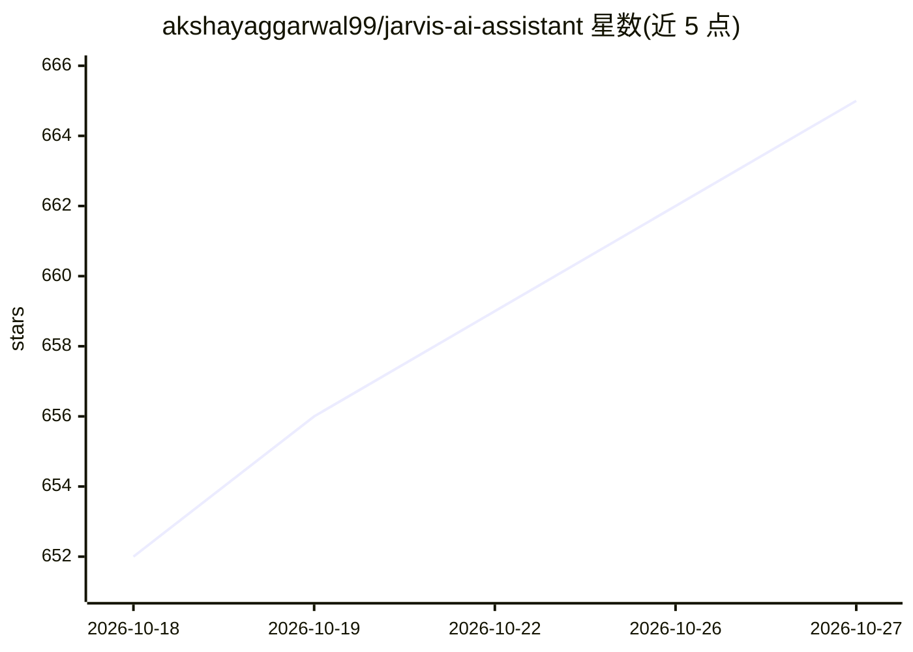

# akshayaggarwal99/jarvis-ai-assistant

⭐ 665 · TypeScript · MIT · 推送 2026-09-23 · [GitHub](https://github.com/akshayaggarwal99/jarvis-ai-assistant) · [官网](https://jarvis.ceo) · 个人维护

**Mac 语音听写助手：按住 Fn 说话，文本出现在任意应用**

面向 Mac（含 iOS TestFlight）的开源语音听写应用：按住 Fn 说话，生成去填充词、修过语法的文本，可执行打开网站、定时器等小指令，并支持提示词定制行为。转录可用本地 Whisper 或 NVIDIA Parakeet（经 Sherpa-ONNX），后处理可用 Ollama 本地 LLM 或 Deepgram+Gemini 云端。提供 Apple Silicon/Intel 的签名 DMG 安装包，也可 Node.js 18+ 环境从源码构建。MIT 许可，无遥测。

## 筛选速览

| 维度 | 判定 | 备注 |
|---|---|---|
| AI 角色 | `ai-native` | 本体是模型或模型工具 |
| 许可风险 | `permissive` | MIT |
| 部署形态 | `library` | 以包/库形式分发 |
| 模型依赖 | local-ok | 支持本地模型 |
| 硬件要求 | — | 无带数字的原话,不猜 |
| 安装摩擦 | `low` | 无编译、无系统依赖或容器化 |
| 成熟度 | — | 结构信号不足 |

## 能力要点

- 本地 Whisper / NVIDIA Parakeet（Sherpa-ONNX）离线转录
- 通过 Ollama 运行本地 LLM 做后处理，或用 Deepgram+Gemini 云端
- 自动去除填充词、修语法，支持重写/要点化/生成文本
- 行为可通过提示词全量定制，声称零遥测

## 适用场景

- 在任意应用中用语音输入并获得清理后的文本
- 完全离线、本地模型的隐私听写
- 用语音执行打开 YouTube、设定时器等小指令

## 场景标签

`AI 助手` `语音识别` `AI 写作` · 领域:对话与助手

## 证据(README 行号)

> L24: - Hold **Fn** → speak → release → clean, punctuated text appears **anywhere**
> L29: - **Fully offline** with local **Whisper** or **NVIDIA Parakeet** (via Sherpa-ONNX)

## 星数曲线

2026-10-18 652 → 2026-10-27 665（+13）

---
*卡片 v1 · prompt 1.4 · 生成 2026-10-21 · 置信度 mid · 依据 README sha `dbbaddc006a8` · [字段定义](../../DATASET.md)*
