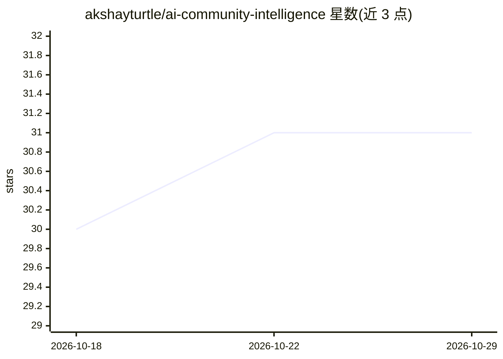

# akshayturtle/ai-community-intelligence

⭐ 31 · Python · MIT · 推送 2026-07-15 · [GitHub](https://github.com/akshayturtle/ai-community-intelligence) · 个人维护

**面向投资人/创始人的社区情报平台：监控25+数据源并用LLM agent产出市场洞察**

开源社区情报平台（自名 Community Mind Mirror）：抓取 Reddit、Hacker News、GitHub、ArXiv、YouTube、招聘板等 25+ 来源，经三层管道处理——无 LLM 的模式匹配（VADER 情感、迁移句抽取）、统计分析（热度 vs 现实指数）、LLM 深度分析（话题提取、人物画像、痛点聚类）——再由 10 个情报 agent 跨源计算牵引力评分、市场空白、竞争威胁等，经 FastAPI 后端与 React 19 仪表盘（14 个视图）呈现。面向 VC、创始人、产品经理、招聘方与财务顾问。需自备 PostgreSQL、Redis、Node.js 与 OpenAI 兼容 API key；多数抓取器无需 API key。LLM 部分依赖外部 API，非本地模型。

## 筛选速览

| 维度 | 判定 | 备注 |
|---|---|---|
| AI 角色 | `ai-native` | 本体是模型或模型工具 |
| 许可风险 | `permissive` | MIT |
| 部署形态 | `self-host` | docker 或自建部署 |
| 模型依赖 | — | README 未给出锁定关系 |
| 硬件要求 | — | 无带数字的原话,不猜 |
| 安装摩擦 | `low` | 无编译、无系统依赖或容器化 |
| 成熟度 | — | 结构信号不足 |

## 能力要点

- 25+ 数据源、200K+ 记录的采集层（Reddit 55 个子版、GitHub 675+ 仓库、57 个 ATS 招聘源）
- 三层分析管道：模式匹配（无 LLM）→ 统计分析 → LLM 深度分析
- 10 个跨源情报 agent（牵引力评分、市场空白检测、技术生命周期等）
- 内置 LLM 花费追踪与预算上限

## 适用场景

- 追踪技术社区讨论热度、情感与叙事变化，辅助投资判断
- 发现开发者痛点与无解市场空白，寻找创业方向
- 监控竞品用户迁移、社区评价与招聘信号
- 查看 AI/ML 自由职业与招聘机会及技能供需缺口

## 场景标签

`金融量化` `数据分析` · 领域:效率与自动化

## 证据(README 行号)

> L3: **Open-source community intelligence platform that monitors 25+ AI/tech data sources, processes signals through LLM-
> L143: **Layer 3 — LLM-Powered Deep Analysis**
> L199: |**LLM**|OpenAI-compatible API (Azure OpenAI / OpenAI / any compatible endpoint)|

## 星数曲线

2026-10-18 30 → 2026-10-29 31（+1）

---
*卡片 v1 · prompt 1.4 · 生成 2026-10-26 · 置信度 mid · 依据 README sha `7171b6e8f6d3` · [字段定义](../../DATASET.md)*
