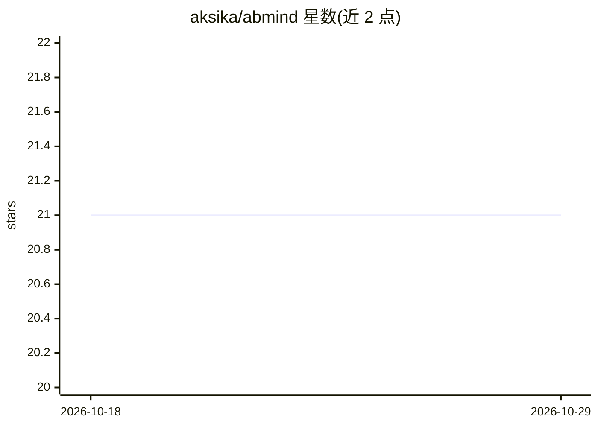

# aksika/abmind

⭐ 21 · TypeScript · Apache-2.0 · 推送 2026-10-26 · [GitHub](https://github.com/aksika/abmind) · [官网](https://aksika.github.io/) · 个人维护

**面向 AI agent 的持久记忆与 RAG 引擎：存储、召回、整理、遗忘**

SQLite 存储的 agent 记忆系统，提供 4 层召回（FTS5 全文检索、trigram 模糊匹配、Ollama 或 OpenAI 兼容端点的 embeddings、整合摘要）与跨层相关性排序。夜间 sleep 维护进程自动提取事实、生成日/周/季摘要、检测矛盾并修剪陈旧记忆，每周期约 10-14 次 LLM 调用。附带回合制多分辨率上下文组装、基于 NATO Admiralty Codes 的密级分类与多用户隔离、AES-256-GCM 凭据加密存储、14 类注入检测。接入方式覆盖 Node.js 库、MCP server、CLI 与 agent hooks（Claude Code、Gemini CLI 等）。

## 筛选速览

| 维度 | 判定 | 备注 |
|---|---|---|
| AI 角色 | `ai-ecosystem` | LLM/agent 周边工具 |
| 许可风险 | `permissive` | Apache-2.0 |
| 部署形态 | `None` |  |
| 模型依赖 | local-ok | 支持本地模型 |
| 硬件要求 | — | 无带数字的原话,不猜 |
| 安装摩擦 | `low` | 无编译、无系统依赖或容器化 |
| 成熟度 | — | 结构信号不足 |

## 能力要点

- 4 层召回：FTS5 + trigram + embeddings + 整合摘要，跨层排序
- 夜间 sleep 维护：事实提取、摘要整合、矛盾检测、陈旧记忆修剪
- 密级分类（0-3 级）与多用户记忆隔离、凭据 AES-256-GCM 加密
- trigram 模糊搜索支持日语/土耳其语/匈牙利语等黏着语形态

## 适用场景

- 为 24/7 运行的多语言 agent 提供长期持久记忆
- 通过 MCP server 给 Claude Code、Gemini CLI、Cursor 等宿主接入记忆
- 让 agent 安全记忆 API key 等凭据而不泄漏到对话历史
- 夜间自动整理对话记忆并生成周期性摘要

## 场景标签

`Agent 记忆` · 领域:Agent 开发

## 证据(README 行号)

> L5: Persistent memory system for AI agents — store, recall, consolidate, and forget.
> L63: - **Embeddings** — semantic similarity via Ollama or any OpenAI-compatible endpoint
> L90: |**MCP server** (`abmind mcp`)|Editors + hosts with MCP support|

## 星数曲线

2026-10-18 21 → 2026-10-29 21（+0）

---
*卡片 v1 · prompt 1.4 · 生成 2026-10-28 · 置信度 high · 依据 README sha `557a855fa791` · [字段定义](../../DATASET.md)*
