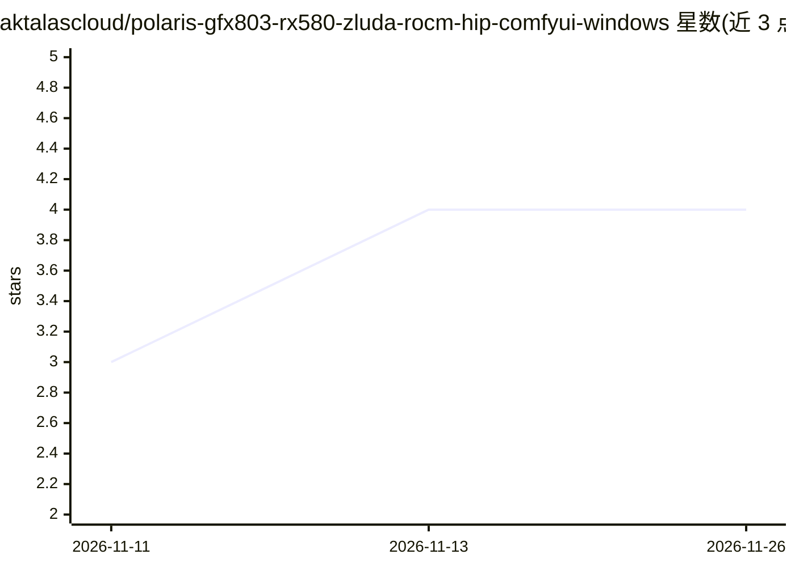

# aktalascloud/polaris-gfx803-rx580-zluda-rocm-hip-comfyui-windows

⭐ 4 · Python · GPL-3.0 · 推送 2026-11-23 · [GitHub](https://github.com/aktalascloud/polaris-gfx803-rx580-zluda-rocm-hip-comfyui-windows) · 个人维护

**为 AMD RX 580 (gfx803) Windows 环境安装固定版本 AI 运行栈的工具**

Windows 安装器，为 AMD Polaris / gfx803 部署固定版本的 ZLUDA、HIP/ROCm、rocBLAS 栈，并可选 DirectML 与 OpenVINO CPU 后端，ComfyUI 为可选组件。安装方式为解压 release ZIP 后运行 Install.cmd，从各发布方拉取固定依赖；要求已有兼容 AMD 驱动、Windows x64、约 20 GiB 空间，不修改驱动。提供多个启动脚本（CUDA/ONNX/DirectML/ComfyUI/ZLUDA 检查等）。README 声明完整 ComfyUI 启动与生成尚未验证，速度数据仅来自早期 attention 实验。源码为 GPL-3.0-only。

## 筛选速览

| 维度 | 判定 | 备注 |
|---|---|---|
| AI 角色 | `ai-ecosystem` | LLM/agent 周边工具 |
| 许可风险 | `viral` | GPL-3.0 |
| 部署形态 | `None` |  |
| 模型依赖 | local-ok | 支持本地模型 |
| 硬件要求 | — | 无带数字的原话,不猜 |
| 安装摩擦 | `medium` | 含编译或系统依赖之一 |
| 成熟度 | `idea` | |

## 能力要点

- 一键安装固定版本的 ZLUDA + HIP/ROCm + rocBLAS 栈
- 提供 DirectML 与 OpenVINO CPU 备选后端
- ComfyUI 可选本地部署（127.0.0.1:8188）
- 含 ZLUDA/CUDA-PTX 检查与进程级 HIP shell 脚本

## 适用场景

- 在 Windows 上让 RX 580 跑 PyTorch CUDA 栈
- 为旧款 AMD GPU 部署可选的 ComfyUI
- 在 DirectML / OpenVINO CPU 后端间做备选运行

## 场景标签

`推理引擎` · 领域:训练与推理

## 证据(README 行号)

> L5: Install a pinned AI stack for AMD Polaris / gfx803 using ZLUDA, HIP/ROCm and rocBLAS, with alternate DirectML and Op
> L35: |Python-CUDA.cmd|PyTorch 2.2.1+cu118, ZLUDA 3.9.5, HIP 5.7.1|
> L38: |Start-ComfyUI.cmd|Optional local UI/API at 127.0.0.1:8188, CPU VAE and automatic bounded attention|

## 星数曲线

2026-11-11 3 → 2026-11-26 4（+1）

---
*卡片 v1 · prompt 1.4 · 生成 2026-11-21 · 置信度 high · 依据 README sha `e0a948622b1b` · [字段定义](../../DATASET.md)*
