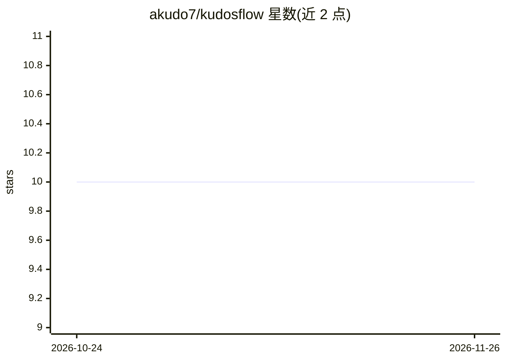

# akudo7/kudosflow

⭐ 10 · TypeScript · NOASSERTION · 推送 2026-03-21 · [GitHub](https://github.com/akudo7/kudosflow) · 个人维护

**VSCode 内的可视化 AI agent 工作流编辑器与执行器**

Kudosflow 是一个 VSCode 扩展：以拖拽节点的方式设计并执行基于节点的 AI agent 工作流，工作流保存为可移植 JSON，支持 Git 版本管理与复用。支持 A2A（Agent-to-Agent）与 MCP 通信协议，提供实时执行、线程持久化状态管理，以及基于 LangGraph 的 Agent Teams 扇出/扇入并行执行（planner→worker×N→aggregator→finalize）。通过 VSIX 安装，需 VSCode 1.96.0 以上，运行需配置 OpenAI、Anthropic 或 Ollama 的凭据。

## 筛选速览

| 维度 | 判定 | 备注 |
|---|---|---|
| AI 角色 | `ai-ecosystem` | LLM/agent 周边工具 |
| 许可风险 | `none` | NOASSERTION |
| 部署形态 | `None` |  |
| 模型依赖 | local-ok | 支持本地模型 |
| 硬件要求 | — | 无带数字的原话,不猜 |
| 安装摩擦 | `low` | 无编译、无系统依赖或容器化 |
| 成熟度 | — | 结构信号不足 |

## 能力要点

- 拖拽式可视化工作流编辑器（基于 React Flow），工作流为可移植 JSON
- 支持 A2A 与 MCP 通信协议及 System Skills 集成
- Agent Teams：基于 LangGraph Send 的并行扇出/扇入执行
- thread_id 会话状态持久化与实时执行测试

## 适用场景

- 在编辑器内搭建可版本管理的 AI agent 工作流
- 通过 A2A 协议将多 agent 步骤组合为流水线
- 并行运行多个专家 agent 并汇总为最终报告

## 场景标签

`Agent 框架` `多智能体` · 领域:Agent 开发

## 证据(README 行号)

> L32: Kudosflow is a VSCode extension that lets you **design and execute node-based AI agent workflows** using a drag-and
> L52: - 🔄 **A2A & MCP Integration**: Support for Agent-to-Agent and MCP communication protocols
> L195: The Agent Teams feature dynamically assembles a team of specialist agents at runtime based on any user prompt. Wor

## 星数曲线

2026-10-24 10 → 2026-11-26 10（+0）

---
*卡片 v1 · prompt 1.4 · 生成 2026-11-20 · 置信度 high · 依据 README sha `75e774e5bd8d` · [字段定义](../../DATASET.md)*
