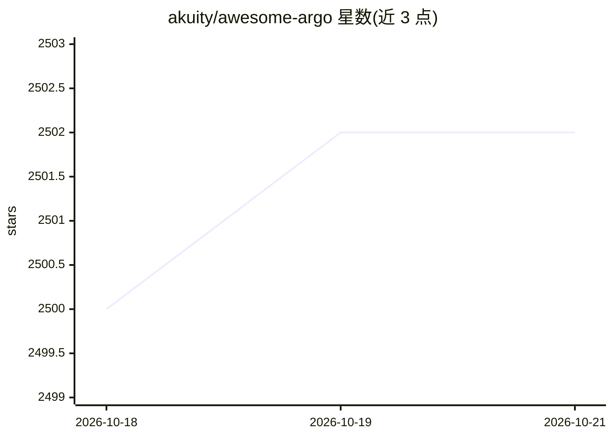

# akuity/awesome-argo

⭐ 2,502 · Apache-2.0 · 推送 2026-09-18 · [GitHub](https://github.com/akuity/awesome-argo) · [官网](https://akuity.github.io/awesome-argo/) · 组织维护

**面向 Argo 生态的策展清单：项目、书籍与博客资源汇总**

由 Akuity 维护并赞助的 Argo 生态资源清单：先介绍 Argo 四大核心项目（Workflows、CD、Rollouts、Events）及 argoproj-labs 社区组织，随后收录生态项目（含 argoproj-labs 精选项目、使用 Argo 的第三方开源工具，如 Hera SDK、Kargo、Devtron 等）、书籍与官方/社区博客文章。README 为目录式编目，不提供本产品的安装或运行方式。

## 筛选速览

| 维度 | 判定 | 备注 |
|---|---|---|
| AI 角色 | `ai-knowledge` | 知识聚合/清单类 |
| 许可风险 | `permissive` | Apache-2.0 |
| 部署形态 | `library` | 以包/库形式分发 |
| 模型依赖 | — | README 未给出锁定关系 |
| 硬件要求 | — | 无带数字的原话,不猜 |
| 安装摩擦 | `medium` | 含编译或系统依赖之一 |
| 成熟度 | — | 结构信号不足 |

## 能力要点

- 收录生态项目、书籍与博客文章三大类资源
- 覆盖 argoproj 与 argoproj-labs 社区项目
- 由 Akuity（Argo 商业公司）维护并赞助

## 适用场景

- 为 Kubernetes 上的 CI/CD 与工作流需求查找 Argo 相关工具
- 发现 Argo 生态的扩展、插件与第三方集成项目
- 查找 Argo 与 GitOps 相关的学习书籍和博客

## 场景标签

`精选清单` · 领域:学习与行业

## 证据(README 行号)

> L13: A curated list of awesome projects and resources related to Argo, a Cloud Native Computing Foundation (CNCF) gradua
> L17: This list is maintained and sponsored by Akuity, the Enterprise Company for Argo Project.

## 星数曲线

2026-10-18 2,500 → 2026-10-21 2,502（+2）

---
*卡片 v1 · prompt 1.4 · 生成 2026-10-21 · 置信度 high · 依据 README sha `fe427faed4e9` · [字段定义](../../DATASET.md)*
