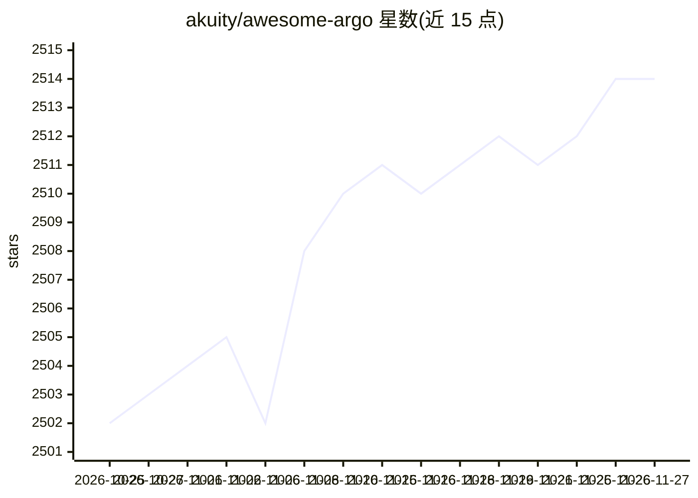

# akuity/awesome-argo

⭐ 2,514 · Apache-2.0 · 推送 2026-11-23 · [GitHub](https://github.com/akuity/awesome-argo) · [官网](https://akuity.github.io/awesome-argo/) · 组织维护

**面向 Argo 生态用户的项目与资源策展清单**

由 Akuity 维护的 awesome 清单，收录与 Argo（CNCF 毕业项目）相关的项目与资源。内容覆盖 Argo 四个核心组件（Workflows、CD、Rollouts、Events）的介绍，argoproj-labs 生态项目（如 Argo CD Agent、Hera SDK）、使用 Argo 的第三方开源项目（CI/CD、MLOps、GitOps 工具），以及相关书籍、会议录像与博客文章链接。清单本身不提供安装或运行功能，仅为链接导航。

## 筛选速览

| 维度 | 判定 | 备注 |
|---|---|---|
| AI 角色 | `ai-knowledge` | 知识聚合/清单类 |
| 许可风险 | `permissive` | Apache-2.0 |
| 部署形态 | `library` | 以包/库形式分发 |
| 模型依赖 | — | README 未给出锁定关系 |
| 硬件要求 | — | 无带数字的原话,不猜 |
| 安装摩擦 | `medium` | 含编译或系统依赖之一 |
| 成熟度 | — | 结构信号不足 |

## 能力要点

- 收录 argoproj 与 argoproj-labs 组织下的生态项目清单
- 列出使用 Argo 的第三方开源项目（含 MLOps/GitOps 工具）
- 整理相关书籍与博客文章链接
- 由 Akuity 赞助维护

## 适用场景

- 查找 Argo CD / Argo Workflows 的周边工具与扩展
- 为 Kubernetes GitOps 落地寻找参考项目与学习资料
- 了解 Argo 生态的项目分布与社区动态

## 场景标签

`精选清单` · 领域:学习与行业

## 证据(README 行号)

> L13: A curated list of awesome projects and resources related to Argo, a Cloud Native Computing Foundation (CNCF) gradua
> L23: Argo consists of a set of open source tools for deploying and running applications and workloads on Kubernetes, inc
> L31: ## Table of Contents

## 星数曲线

2026-10-25 2,502 → 2026-11-27 2,514（+12）

---
*卡片 v1 · prompt 1.4 · 生成 2026-11-24 · 置信度 high · 依据 README sha `4cc2303e0786` · [字段定义](../../DATASET.md)*
